# Compte rendu : sécuriser une architecture microservices Spring / Angular avec Keycloak

Ce compte rendu décrit, dans l'ordre des trois vidéos du professeur, tout ce qui a été réalisé dans le projet `ecom-bdcc-app` : la mise en place de Keycloak, la création et la sécurisation des microservices Spring Boot, puis le frontend Angular connecté à Keycloak. Pour chaque étape, il explique ce qui a été fait, pourquoi, et ce qui s'est passé. Les difficultés rencontrées et leurs solutions sont regroupées à la fin, car elles permettent de mieux comprendre le fonctionnement de la sécurité.

> **Note sur les données sensibles :** les mots de passe, tokens et secrets réels ont été remplacés par des marqueurs (`<MOT_DE_PASSE>`, `<ACCESS_TOKEN>`, `<CLIENT_SECRET>`). Ne publiez jamais ces valeurs : un access token copié reste utilisable jusqu'à son expiration.

---

## 0. Objectif et architecture

L'objectif est de protéger deux services métier (un inventaire de produits et un service de commandes) et une application web, sans que chaque service gère lui-même les utilisateurs. C'est **Keycloak** qui authentifie les utilisateurs et délivre des jetons JWT. Les services Spring vérifient ensuite ces jetons, et Angular les envoie à chaque requête.


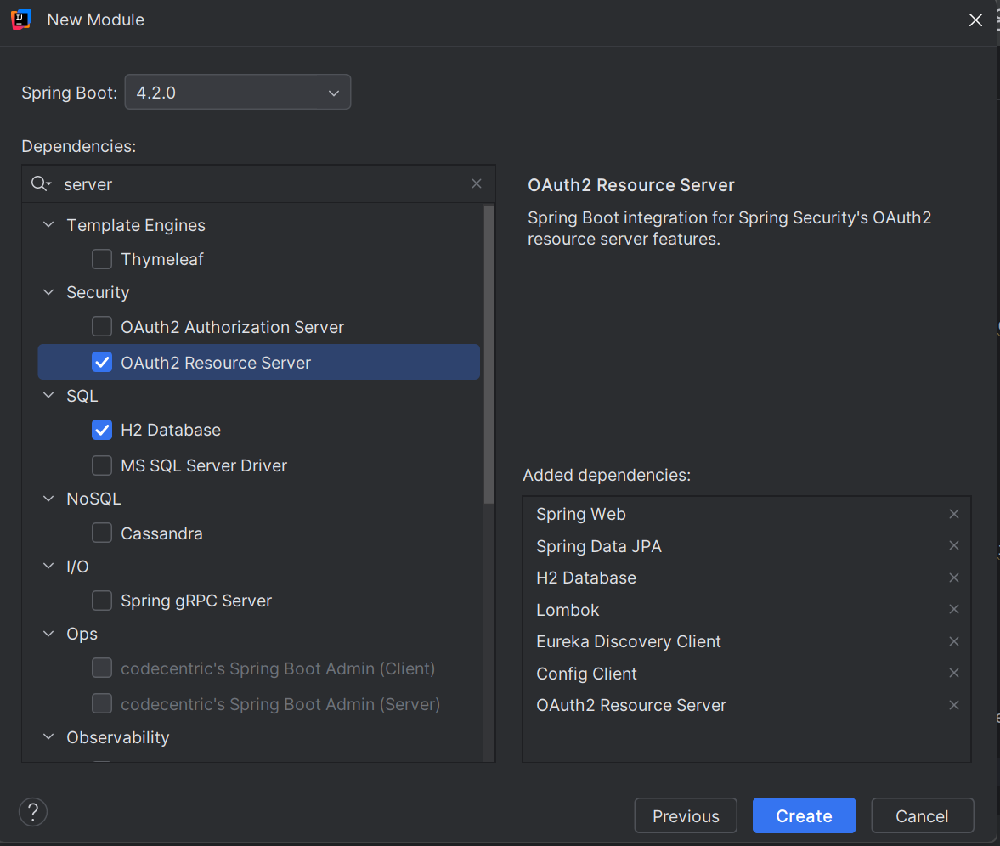
L'architecture est la suivante :

- **Keycloak** (port 8180, realm `enset-bdcc-realme`) : authentification, gestion des utilisateurs, rôles, délivrance des tokens.
- **inventory-service** (port 8087) : gère les produits, protégé par JWT.
- **order-service** (port 8088) : gère les commandes, appelle l'inventaire avec Feign, protégé par JWT.
- **Frontend Angular** (port 4200) : redirige vers Keycloak pour la connexion, puis appelle les deux services avec le token.


Le cours utilise le realm `bdcc` et des ports par défaut. Dans ce projet, le realm s'appelle `enset-bdcc-realme` et Keycloak tourne sur le port `8180`, car le port `8080` était déjà occupé par Jenkins. Ces valeurs sont utilisées partout dans la suite.

---

## Partie 1 : Keycloak (vidéo 1)

### 1.1 Téléchargement et démarrage

Keycloak se télécharge depuis le site officiel, puis s'extrait. Le démarrage se fait depuis le dossier `bin` avec `kc.bat start-dev` sous Windows, ou `kc.sh start-dev` sous Linux et macOS. Le mode `start-dev` utilise une base H2 en fichier : c'est suffisant pour le développement, mais pas pour la production.


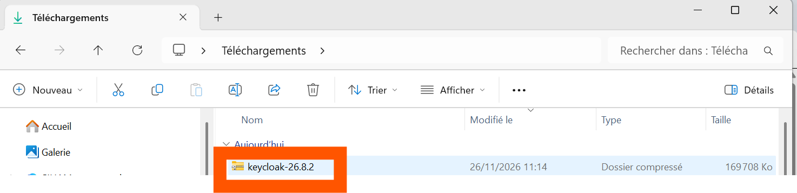


### 1.2 Création de l'administrateur

Avec la version 26 de Keycloak, l'administrateur initial se définit par des variables d'environnement avant le premier démarrage (`KC_BOOTSTRAP_ADMIN_USERNAME` et `KC_BOOTSTRAP_ADMIN_PASSWORD`). Une fois connecté à la console d'administration, on accède à toutes les fonctions de gestion.


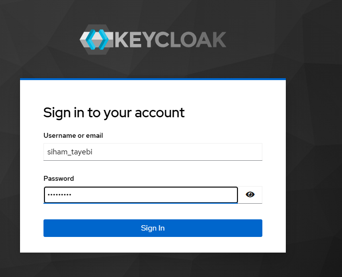


### 1.3 Création du realm

Un **realm** est le territoire à sécuriser : il regroupe les utilisateurs, les rôles et les clients qui partagent la même identité. Le realm créé ici s'appelle `enset-bdcc-realme`.


### 1.4 Création du client

Un **client** représente une application qui s'appuie sur Keycloak. Pour les tests, un client `app-test` a été créé avec les paramètres par défaut. Pour un frontend, il faudra renseigner les **Valid redirect URIs** et les **Web origins** avec l'adresse de l'application (`http://localhost:4200`), sans quoi les appels seront bloqués.


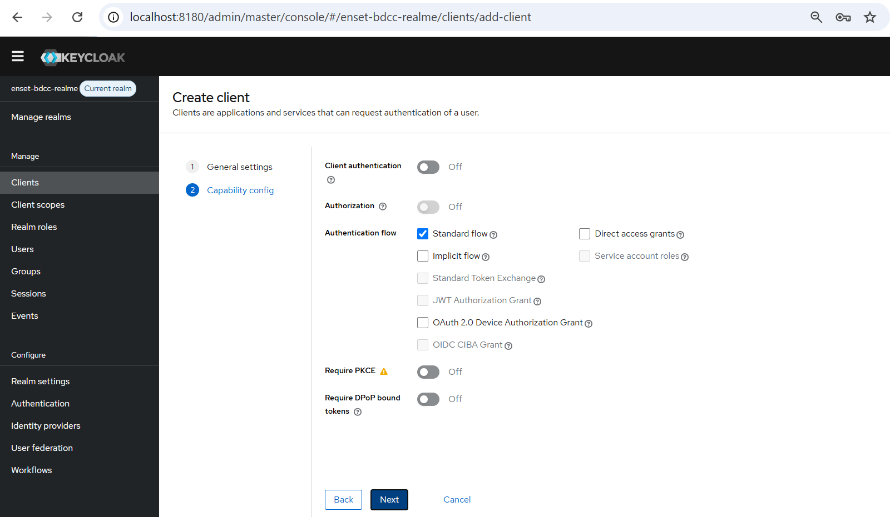

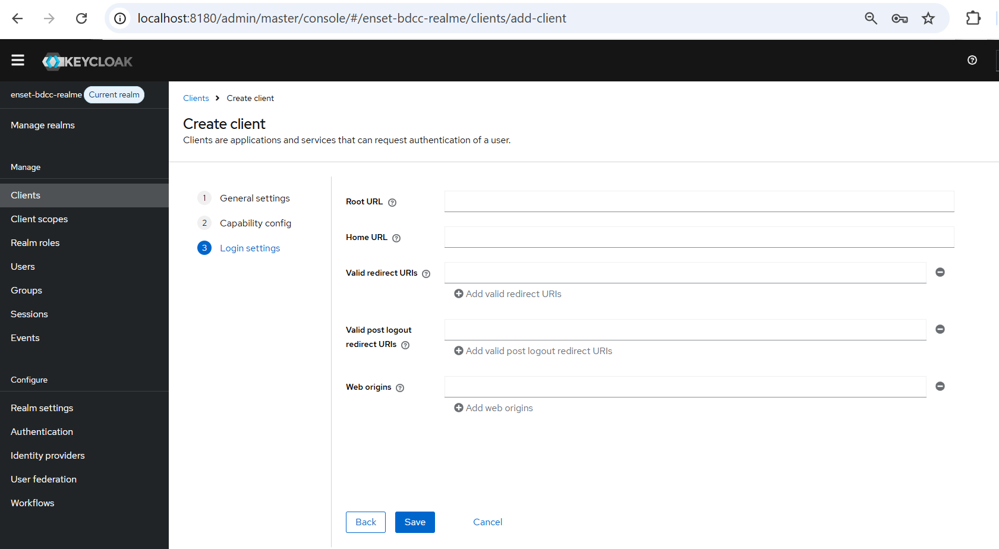


### 1.5 Création des rôles

Deux rôles de royaume (**Realm roles**) sont créés : `user` et `admin`. Ils seront placés dans le token et utilisés pour autoriser l'accès aux ressources.


### 1.6 Création des utilisateurs

Deux utilisateurs de test sont créés : `user1` et `user2`. Le mot de passe est défini dans l'onglet **Credentials**, et l'option **Temporary** est désactivée, pour que l'utilisateur ne soit pas obligé de le changer à la première connexion.


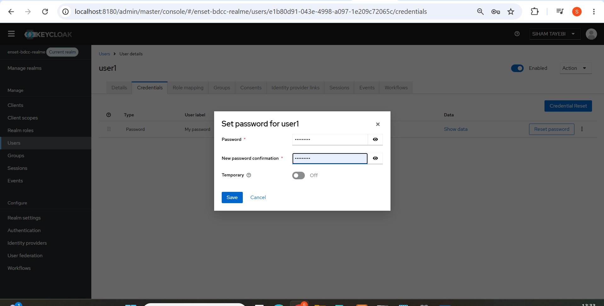


### 1.7 Affectation des rôles

Dans l'onglet **Role mapping** de chaque utilisateur, on attribue les rôles :

- `user1` reçoit le rôle `user` ;
- `user2` reçoit les rôles `user` et `admin`.

Cette différence permettra de tester les accès : `user2` verra les produits, `user1` non.


### 1.8 Authentification par mot de passe (grant `password`)

Le **token endpoint** est l'adresse à laquelle on demande un token. Keycloak l'indique dans la configuration OpenID de chaque realm (**Realm settings > Endpoints**). Une requête `POST` avec le type `application/x-www-form-urlencoded` contient les paramètres `grant_type=password`, `username`, `password` et `client_id`.


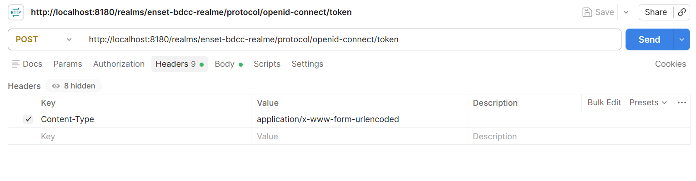

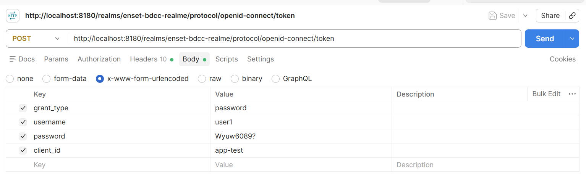

Le grant `password` exige l'option **Direct access grants** sur le client. Sans elle, Keycloak répond `unauthorized_client`. Elle a donc été activée dans les paramètres du client, comme le montre la capture.


La réponse contient un `access_token` (valide 300 secondes, soit 5 minutes) et un `refresh_token` (valide 1800 secondes, soit 30 minutes).


Le contenu de l'access token peut être lu sur le site **jwt.io**. On y trouve la date d'expiration (`exp`), l'identifiant de l'utilisateur (`sub`), les rôles dans `realm_access.roles`, et les informations de profil. La signature utilise l'algorithme RS256 ; le refresh token, lui, est signé en HMAC et ne contient ni rôles ni profil.


### 1.9 Renouvellement du token (grant `refresh_token`)

Quand l'access token expire, on n'a pas besoin de redemander le mot de passe : on envoie le `refresh_token` avec `grant_type=refresh_token`. Keycloak renvoie alors un nouvel access token et un nouveau refresh token. C'est la méthode utilisée par les applications mobiles.


### 1.10 Authentification par secret (grant `client_credentials`)

Ce grant sert à la communication **entre services**, sans utilisateur. Il faut activer **Client authentication** sur le client, cocher **Service accounts roles**, puis récupérer le **Client secret** dans l'onglet **Credentials**.

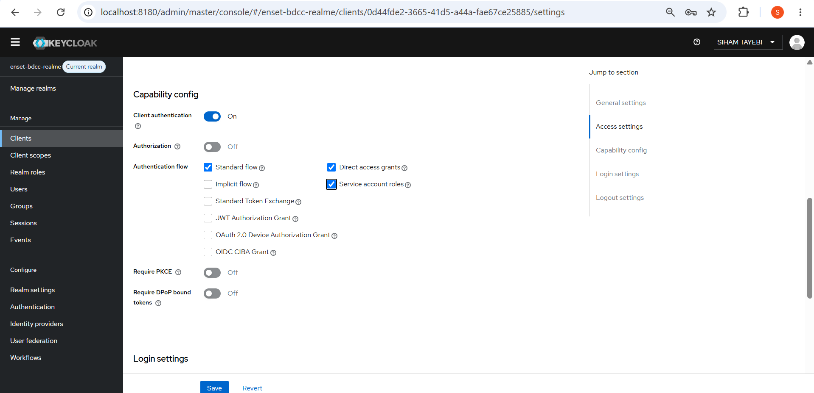

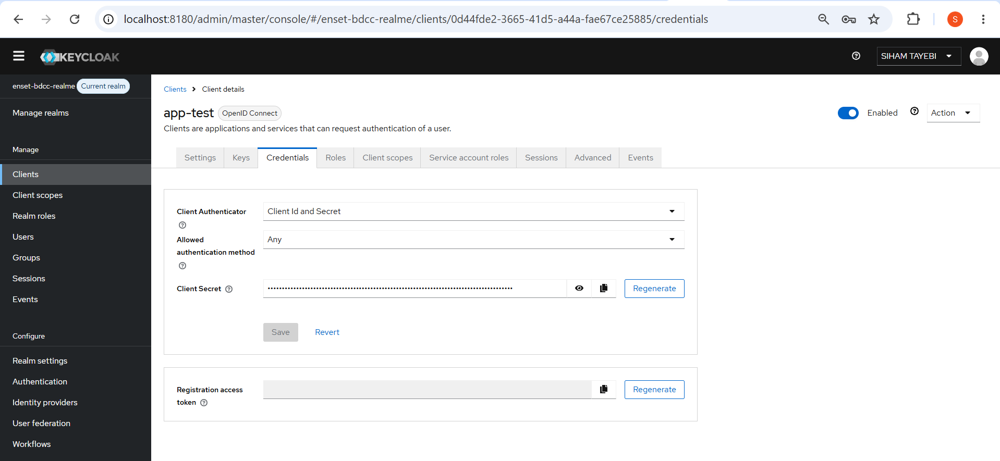


La requête contient alors `grant_type=client_credentials`, le `client_id` et le `client_secret`. Le token est renvoyé sans username ni mot de passe.

Un point important : une fois **Client authentication** activé, le grant `password` exige aussi le `client_secret`, sinon la requête est refusée.


### 1.11 Options de configuration

L'onglet **Realm settings > Login** permet d'activer l'inscription des utilisateurs, la réinitialisation du mot de passe, la mémorisation de la session (*Remember me*), la connexion par adresse e-mail et la vérification de l'e-mail. Les thèmes personnalisent la page de connexion. Les **User Federation** permettent de déléguer les identités à un annuaire LDAP ou Active Directory, et les **Identity Providers** à GitHub, Google ou Facebook.

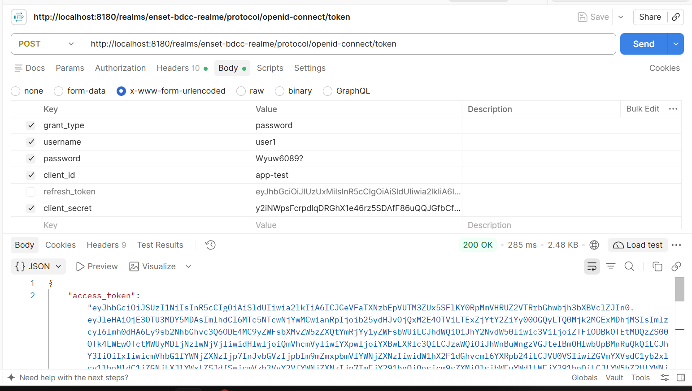

---

## Partie 2 : inventory-service et frontend Angular (vidéo 2)

### 2.1 Création du microservice inventory-service

Le module `inventory-service` est créé avec Spring Initializr, en Java 21 et Spring Boot 3.2.x. Les dépendances utilisées sont : Spring Web, Spring Data JPA, H2, Lombok, Eureka Discovery Client, Config Client et OAuth2 Resource Server. L'OAuth2 Resource Server est la dépendance qui permet au microservice de vérifier les tokens JWT émis par Keycloak.

Le service comprend une entité `Product` (identifiant, nom, prix, quantité), un repository `ProductRepository` qui étend `JpaRepository`, et un contrôleur `ProductController` exposant `/api/products` et `/api/products/{id}`.

Un premier test, sans sécurité, est fait dans le navigateur. Comme Spring Security protège toutes les routes par défaut, la réponse est un refus (401).


La console H2 est accessible à l'adresse `/h2-console`, à condition de l'autoriser dans la configuration de sécurité (les frames doivent être activées pour la console).

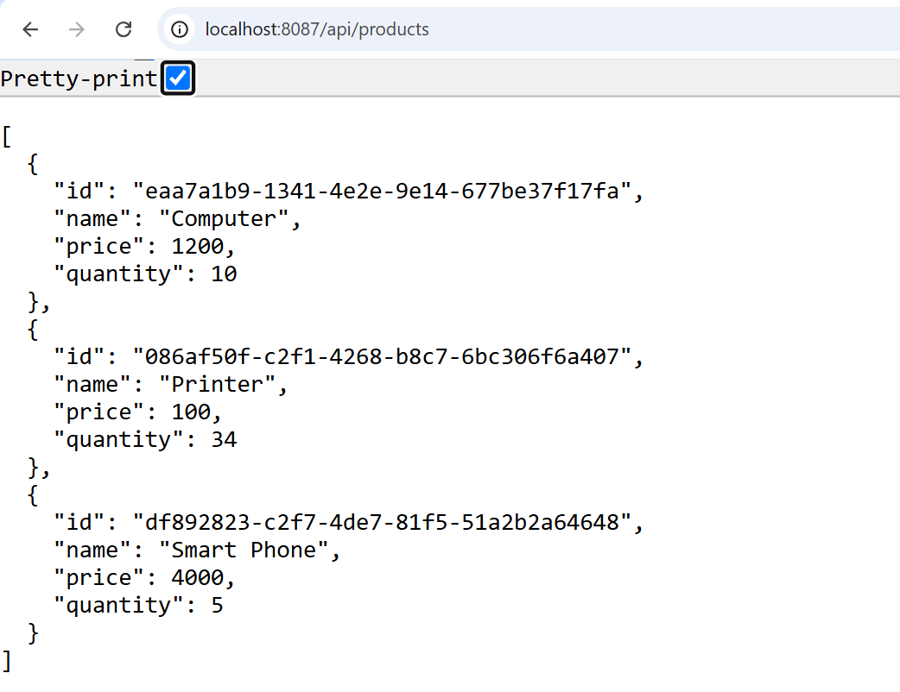

### 2.2 Configuration de sécurité initiale

Pour développer le frontend sans bloquer, le professeur conseille de commencer par une configuration qui autorise les routes `/api/**`, puis de la durcir ensuite. La protection CSRF est désactivée, car l'authentification est *stateless* (JWT) : sans cela, les requêtes `POST` recevraient un 403.

Les codes d'erreur ont ici une signification précise :

| Code | Signification |
|---|---|
| **401** | Non authentifié : pas de token, ou token invalide ou expiré |
| **403** | Authentifié, mais sans le droit demandé (rôle insuffisant) |

### 2.3 Problème CORS

Le navigateur bloque les appels d'Angular (port 4200) vers Spring (port 8087) si le serveur ne l'autorise pas explicitement. L'erreur affichée est *blocked by CORS policy*.


Une solution rapide consiste à ajouter `@CrossOrigin(origins = "*")` sur le contrôleur. Elle fonctionne sur une route publique, comme le montre la capture, mais elle ne suffit pas pour les routes protégées par Spring Security. La solution correcte est un bean `CorsConfigurationSource`, utilisé par la chaîne de sécurité avec `http.cors(Customizer.withDefaults())`.

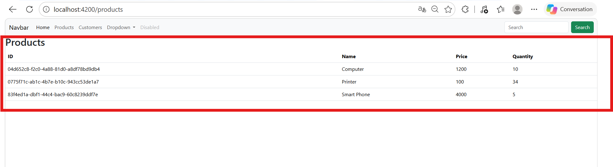

Après cette configuration, les produits s'affichent correctement dans Angular.


### 2.4 Création du frontend Angular

Le projet Angular est généré avec `ng new`, en mode NgModule (`--no-standalone`) et sans SSR. Bootstrap et bootstrap-icons sont installés, puis déclarés dans `angular.json`.


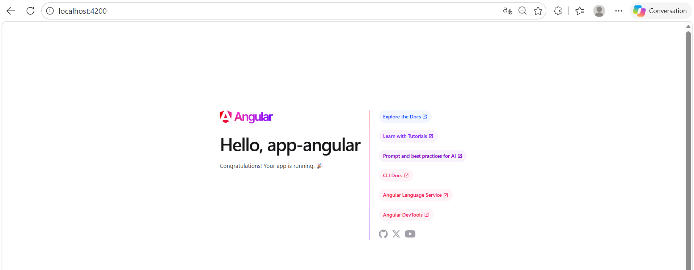

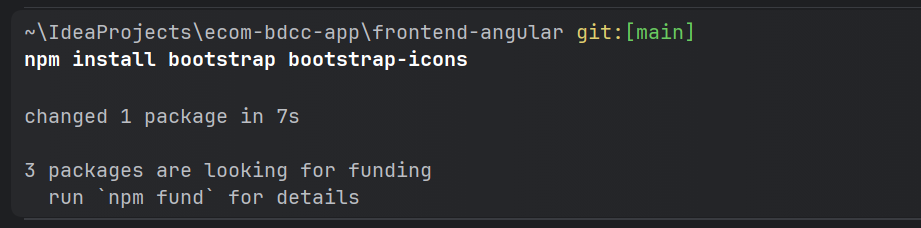

Une barre de navigation Bootstrap est ajoutée dans le composant principal, avec un `<router-outlet>` pour afficher les pages. Deux composants sont générés : `products` et `customers`.

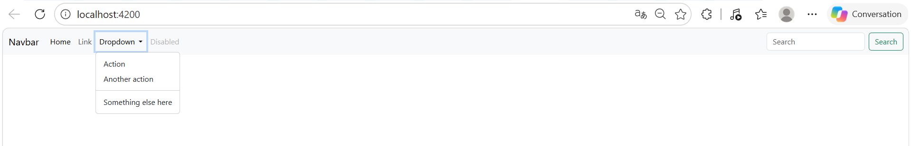

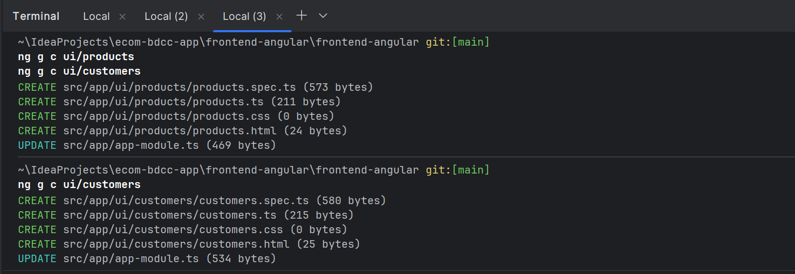

Au départ, les pages `customers` et `products` s'affichent sans données.

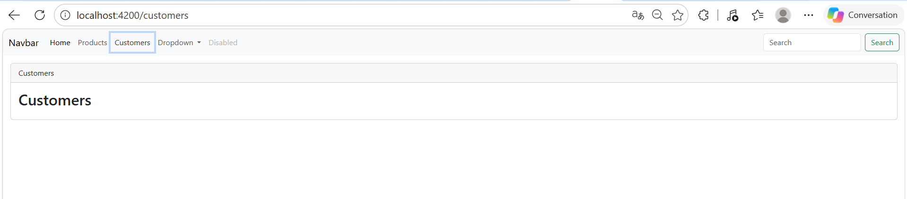

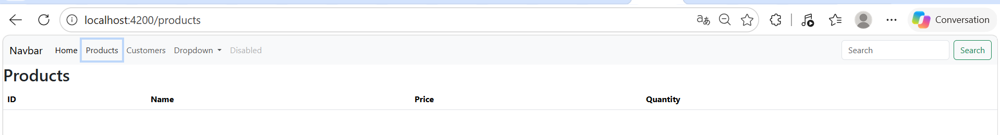

### 2.5 Client Keycloak pour Angular

Pour le frontend, un client public `ecom-client-ang` est créé dans Keycloak. Il ne doit pas avoir de **Client authentication** : une application Angular est exécutée dans le navigateur, où un secret serait visible par tout le monde.


### 2.6 Tests du token depuis IntelliJ

Dans l'éditeur HTTP d'IntelliJ, on demande un token avec le grant `password`, puis avec le `refresh_token`. Les requêtes passent et renvoient les tokens attendus.

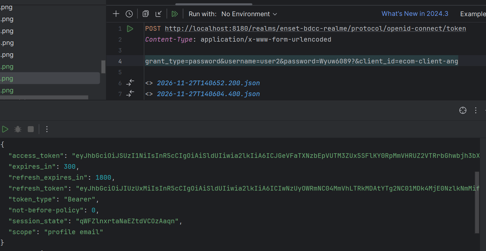


Pour le grant `client_credentials`, le client secret est récupéré dans les paramètres du client, puis utilisé dans la requête.


La combinaison du refresh token et du client secret est aussi acceptée, comme le montre la capture de réussite.

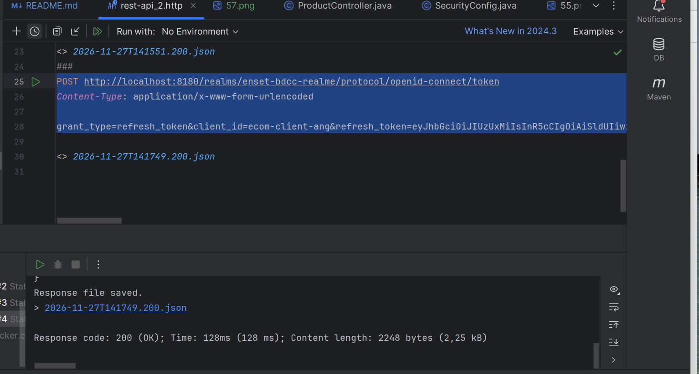

### 2.7 Sécurisation de inventory-service avec le JWT

La configuration de sécurité est mise à jour : `oauth2ResourceServer` est ajouté, avec la propriété `jwk-set-uri` qui indique à Spring où récupérer la clé publique de Keycloak pour vérifier la signature des tokens. Cette adresse doit correspondre exactement au realm et au port de Keycloak :

```properties
spring.security.oauth2.resourceserver.jwt.jwk-set-uri=http://localhost:8180/realms/enset-bdcc-realme/protocol/openid-connect/certs
```

Après redémarrage, l'appel à `/api/products` sans token donne bien 401. Avec le token dans le header `Authorization: Bearer <ACCESS_TOKEN>`, la requête est acceptée.

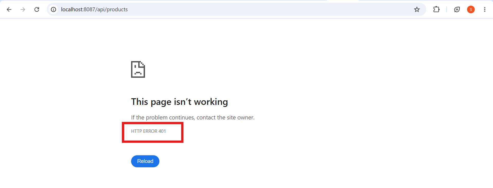


Pour voir ce que Spring a compris du token, un endpoint de test `/api/auth` renvoie l'objet `Authentication`. Il permet de vérifier les autorités réelles de l'utilisateur.

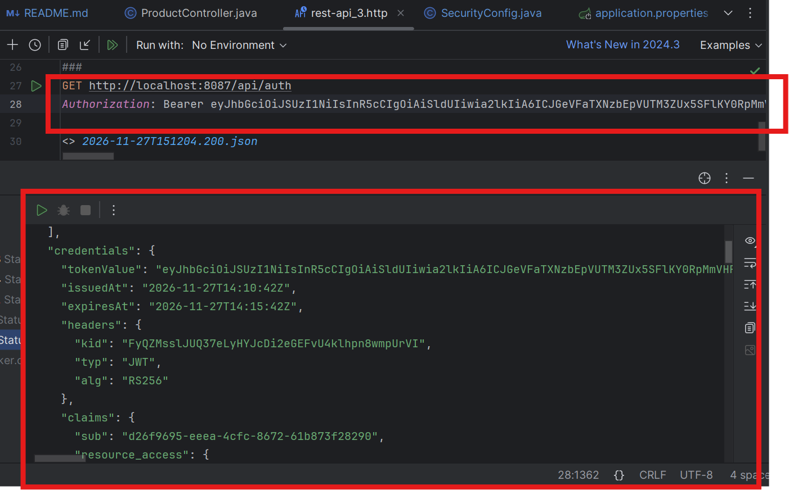

### 2.8 Rôles et autorisations

Par défaut, Spring lit les autorités dans le claim `scope`. Keycloak range les rôles dans `realm_access.roles`, donc un convertisseur personnalisé (`JwtAuthConverter`) est nécessaire pour les lire.

Les règles par rôle sont ensuite appliquées avec `hasAuthority`. Dans le test, la règle sur les produits exige le rôle `ADMIN` :

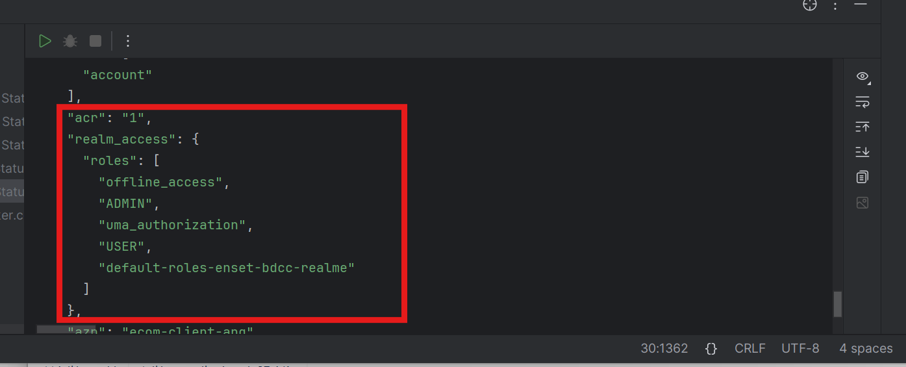

Les autorités affichées par `/api/auth` confirment que le token contient bien les rôles de l'utilisateur.


Avec `user1`, qui n'a pas le rôle `admin`, l'accès à la liste des produits est refusé (403) :


La version finale utilise aussi l'annotation `@PreAuthorize` sur les méthodes du contrôleur, avec `@EnableMethodSecurity(prePostEnabled = true)` dans la configuration :

```java
@GetMapping("/products")
@PreAuthorize("hasAuthority('ADMIN')")
public List<Product> productList() { 
    //
}

@GetMapping("/products/{id}")
@PreAuthorize("hasAuthority('USER')")
public Product productById(@PathVariable String id) { 
    //
}
```

Les rôles sont donc en **majuscules**, comme dans le token. Une règle écrite en minuscules (`admin`) ne correspond pas à `ADMIN` : c'est une erreur fréquente, qui provoque des 403 inattendus.

### 2.9 Sécuriser le frontend avec Keycloak

Le package `keycloak-angular` (avec `keycloak-js`) est installé. Son initialisation se fait avant le démarrage de l'application, grâce à `APP_INITIALIZER`. Elle indique l'adresse de Keycloak, le realm, le client et le mode de vérification de session (`check-sso`).

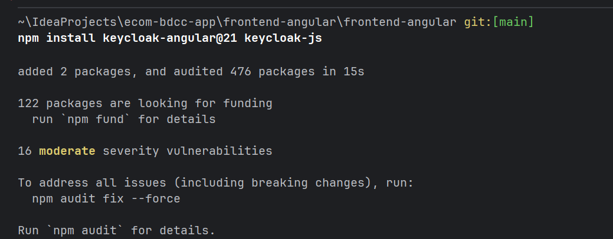

Le fichier `silent-check-sso.html`, placé dans `src/assets/`, permet à Keycloak de vérifier la session sans recharger toute l'application.

```ts
function initializeKeycloak(keycloak: KeycloakService) {
  return () =>
    keycloak.init({
      config: {
        url: 'http://localhost:8180',
        realm: 'enset-bdcc-realme',
        clientId: 'ecom-client-ang',
      },
      initOptions: {
        onLoad: 'check-sso',
        checkLoginIframe: false,
        silentCheckSsoRedirectUri: window.location.origin + '/assets/silent-check-sso.html',
      },
      enableBearerInterceptor: true,
    });
}
```

L'option `enableBearerInterceptor: true` ajoute automatiquement le header `Authorization` à chaque requête HTTP. Il n'est donc plus nécessaire de le construire à la main dans chaque composant.

### 2.10 Protection des routes avec un guard

Un guard (`AuthGuard`, qui étend `KeycloakAuthGuard`) vérifie deux choses avant d'ouvrir une route : l'utilisateur est-il connecté, et possède-t-il les rôles demandés ? Si l'utilisateur n'est pas connecté, il est redirigé vers Keycloak, puis ramené sur la page demandée.


Les routes déclarent les rôles nécessaires dans `data` :

```ts
const routes: Routes = [
  { path: 'products', component: Products, canActivate: [AuthGuard], data: { roles: ['ADMIN'] } },
  { path: 'customers', component: Customers, canActivate: [AuthGuard], data: { roles: ['USER'] } },
];
```

Une erreur 403 apparaît si le client Keycloak est configuré avec un secret : c'est la même cause que précédemment. La configuration du client doit être publique, sans **Client authentication**.


Lorsque l'utilisateur n'est pas connecté, la route `products` redirige vers la page de connexion Keycloak :

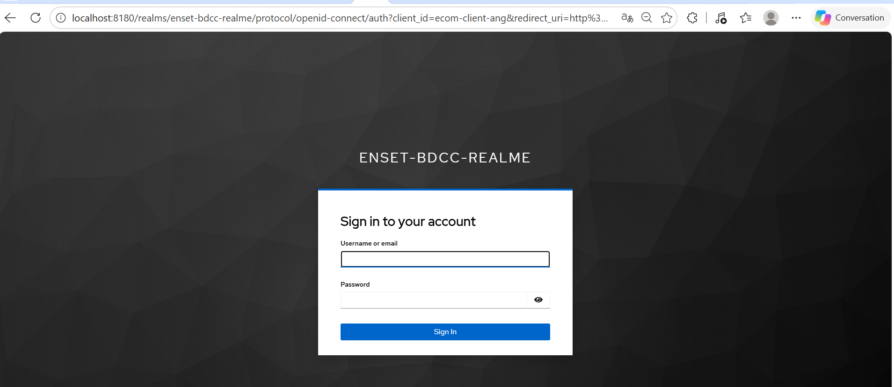

Une fois connecté avec un compte qui a le rôle `ADMIN`, la liste des produits s'affiche :


### 2.11 Navigation selon les rôles

La barre de navigation n'affiche que les liens auxquels l'utilisateur a droit, grâce à `keycloak.isUserInRole(...)`. C'est une aide pour l'interface : la sécurité réelle reste côté backend et dans le guard.

Avec `user2` (rôles `user` et `admin`), les deux liens `products` et `customers` apparaissent :


Avec `user1` (rôle `user` seul), le lien `products` n'apparaît pas :


### 2.12 Amélioration du formulaire de connexion

Dans Keycloak, **Realm settings > Login**, plusieurs options sont activées : l'inscription (*User registration*), la réinitialisation du mot de passe (*Forgot password*), la mémorisation de la session (*Remember me*) et la connexion par e-mail.

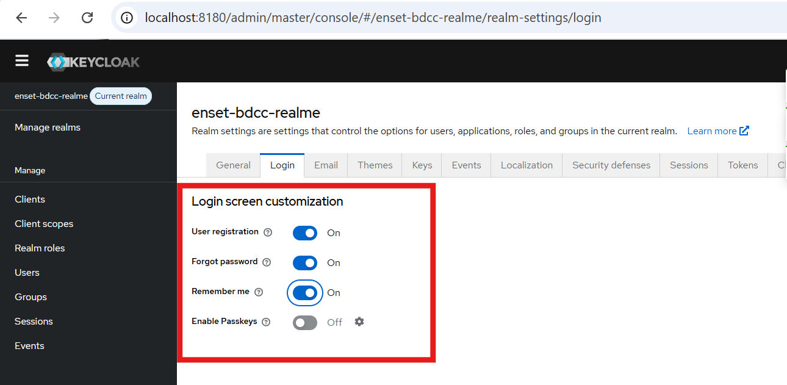

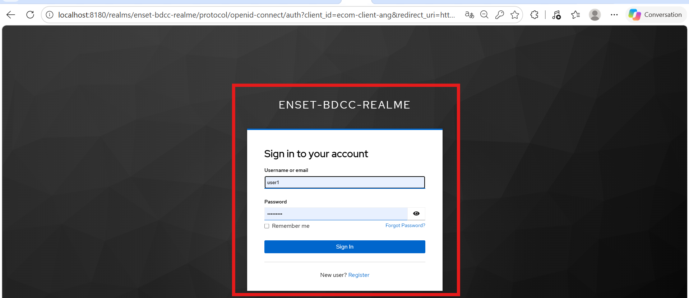

Le formulaire affiche alors les liens correspondants, et un nouvel utilisateur peut s'inscrire.


Pour donner automatiquement le rôle `user` aux nouveaux inscrits, on le définit comme rôle par défaut du realm. Le nouvel utilisateur reçoit alors ce rôle dès sa création.


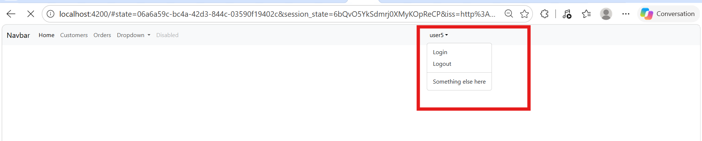

### 2.13 Double authentification (OTP)

Pour renforcer la sécurité, l'OTP peut être demandé à un utilisateur. Dans sa fiche (**Required user actions**), on ajoute **Configure OTP**. À la connexion suivante, Keycloak affiche un QR code à scanner avec une application comme Google Authenticator. Ensuite, l'application génère un code qui change périodiquement, et que l'utilisateur saisit à chaque connexion.

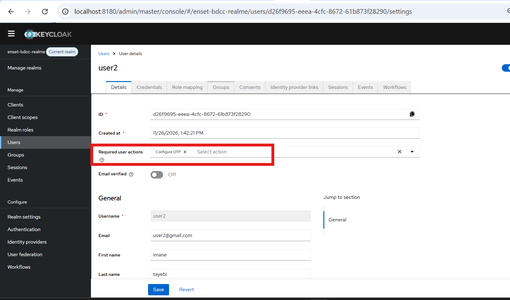


Le professeur indique une période de 15 secondes, alors que la valeur par défaut de Keycloak est de 30 secondes. Le principe est le même : le QR code transmet une clé secrète partagée, et Keycloak et l'application calculent le même code à partir de cette clé et de l'heure. Aucune communication n'est nécessaire pendant l'utilisation.

La politique de mots de passe se configure dans **Authentication > Policies > Password policy** : durée de validité, nombre minimal de caractères, majuscules, chiffres, caractères spéciaux, interdiction de réutiliser les anciens mots de passe.


Les thèmes permettent enfin de personnaliser la page de connexion, à partir d'un thème existant ou d'un thème créé par copie.

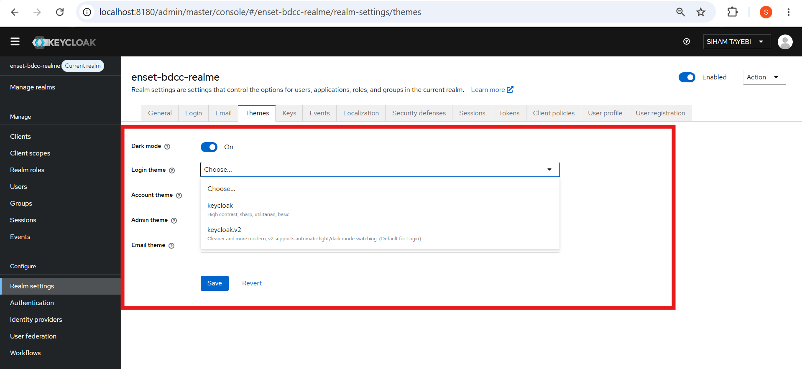

### 2.14 Tests du frontend (partie 2)

| Test | Résultat attendu |
|---|---|
| Ouvrir `localhost:4200` sans être connecté | Interface visible, bouton Login |
| Cliquer sur `products` sans être connecté | Redirection vers Keycloak |
| Se connecter avec `user1` | Lien `customers` visible, pas `products` |
| Accéder à `/products` avec `user1` | Refus (rôle `ADMIN` requis) |
| Se connecter avec `user2` | Liens `products` et `customers` visibles |
| Afficher les produits avec `user2` | Liste affichée (token envoyé automatiquement) |
| Cliquer sur Logout | Déconnexion |

---

## Partie 3 : order-service et commandes (vidéo 3)

### 3.1 Création du microservice order-service

Le module `order-service` est créé avec les mêmes conventions que l'inventaire. Ses dépendances ajoutent **OpenFeign**, qui permet d'appeler `inventory-service` comme une simple interface Java, et la documentation **Swagger** (springdoc).

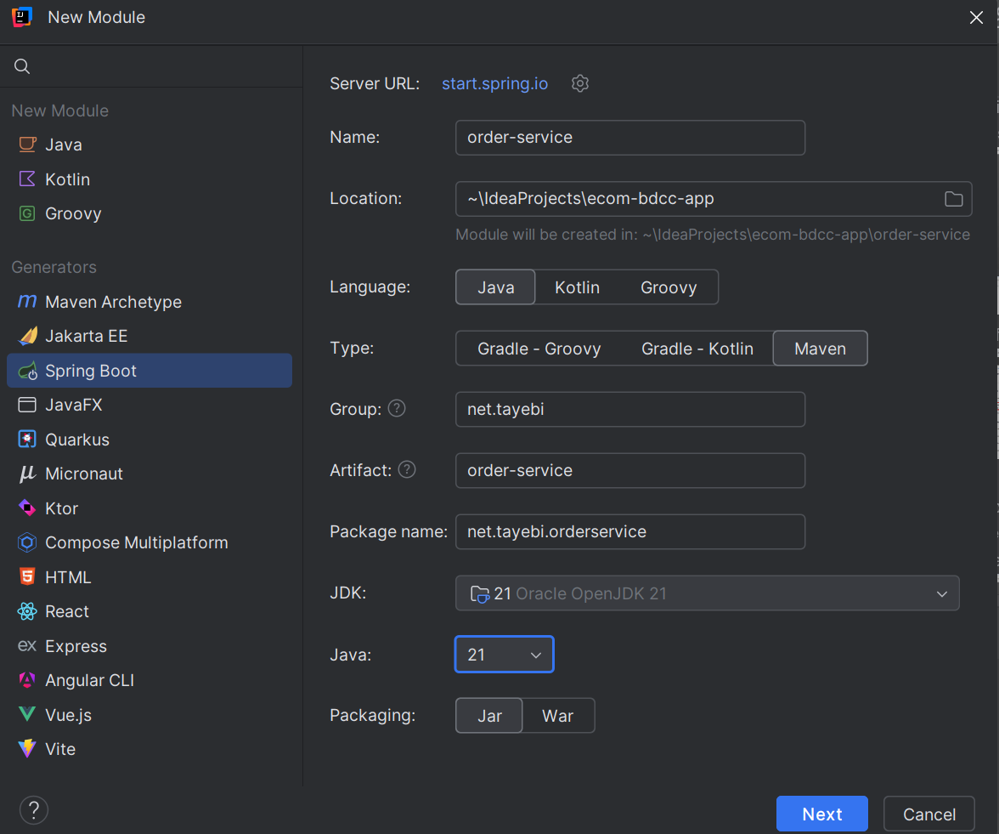

Le service est configuré sur le port 8088, avec sa propre base H2 (`order-db`) et la propriété `jwk-set-uri` pour vérifier les tokens.

### 3.2 Modèle de données

Le modèle comprend trois éléments :

- `Order` : identifiant, date, état (`PENDING`, `CONFIRMED`, `CANCELLED`) et liste de lignes de commande. La table s'appelle `orders`, car `order` est un mot réservé en SQL.
- `ProductItem` : une ligne de commande, avec l'identifiant du produit, le prix, la quantité et la référence vers la commande. L'attribut `product` est annoté `@Transient` : il n'est pas enregistré en base, il sert à afficher le détail du produit récupéré dans l'inventaire.
- Les deux entités sont liées par une relation bidirectionnelle. Pour éviter une boucle infinie lors de la conversion en JSON, la référence vers la commande est annotée `@JsonProperty(access = WRITE_ONLY)`.

Les données de test sont créées au démarrage par un `CommandLineRunner`, qui crée cinq commandes contenant chacune les produits `P01`, `P02` et `P03`. Les tables se vérifient dans la console H2.

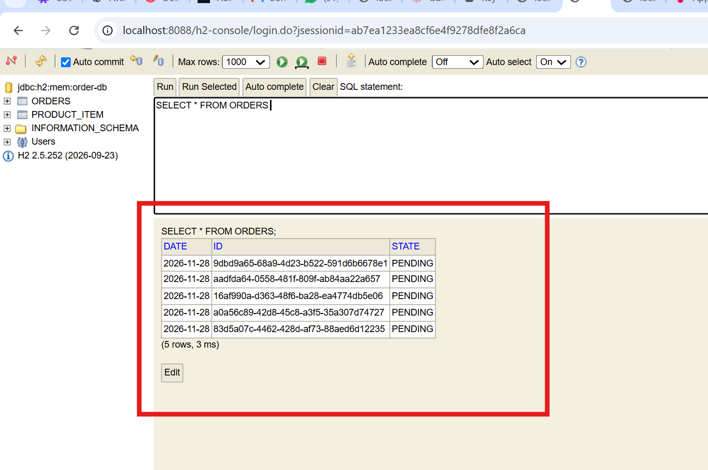

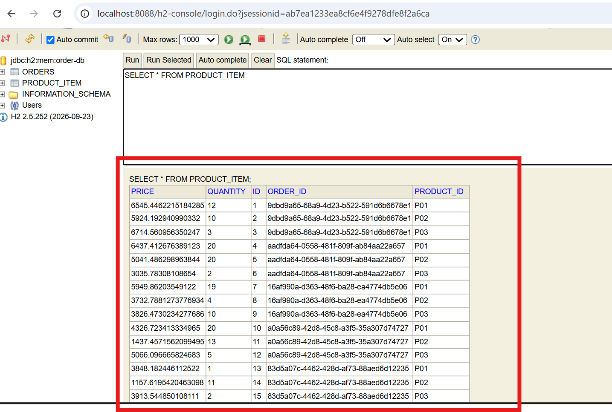

### 3.3 Consultation des commandes

Les endpoints `/api/orders` (liste) et `/api/orders/{id}` (détail) renvoient les commandes. Dans un premier temps, les noms des produits ne sont pas récupérés : la réponse contient seulement les identifiants `productId`.


La documentation Swagger permet aussi de tester ces endpoints. Son accès doit être autorisé dans la configuration de sécurité (`/swagger-ui/**` et `/v3/api-docs/**`).


### 3.4 Enrichissement avec les produits de l'inventaire

Le contrôleur appelle ensuite `inventory-service` via Feign pour chaque ligne de commande, et remplit l'attribut `product`. La liste et le détail affichent alors le nom, le prix et la quantité du produit.

```java
@GetMapping("/orders")
public List<Order> findAllOrders() {
    List<Order> allOrders = orderRepository.findAll();
    allOrders.forEach(o -> o.getProductItems().forEach(pi ->
            pi.setProduct(inventoryRestClient.findProductById(pi.getProductId()))));
    return allOrders;
}
```


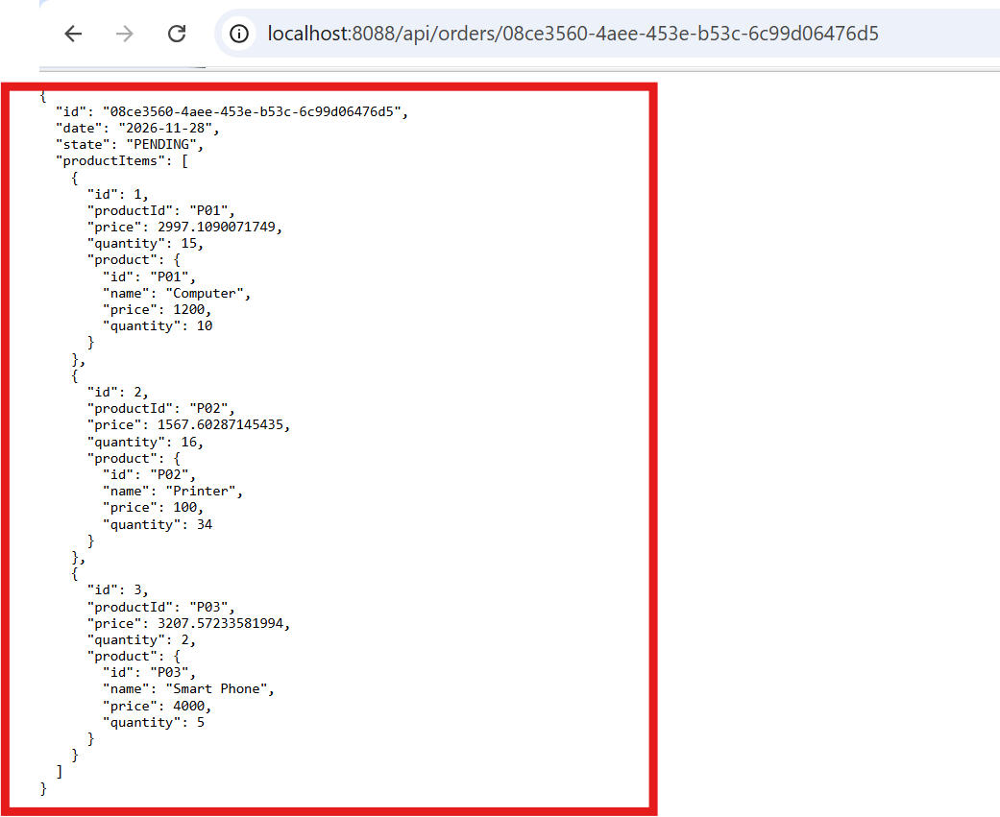

Dans la documentation Swagger, le détail d'une commande affiche bien les produits :


### 3.5 Sécurisation de order-service

Une fois la sécurité activée sur `/api/orders/**`, l'appel direct à `http://localhost:8088/api/orders` renvoie 401 : c'est le comportement attendu, puisque le navigateur n'envoie pas de token depuis la barre d'adresse.

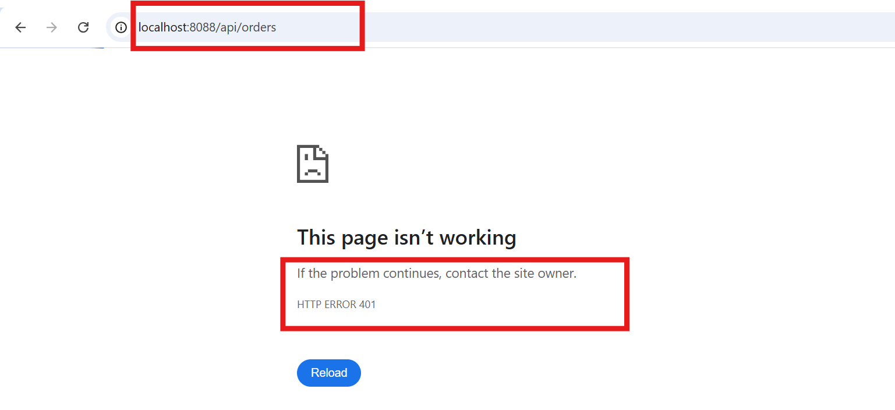

Le professeur montre alors comment obtenir un token et l'utiliser dans une requête. L'appel à `order-service` avec le header `Authorization: Bearer <ACCESS_TOKEN>` renvoie la liste des commandes avec leurs produits.


### 3.6 Transmission du token à inventory-service (Feign)

Quand `order-service` appelle `inventory-service` pour récupérer un produit, il faut transmettre le même token. Sinon, l'inventaire répond 401. Un intercepteur Feign (`RequestInterceptor`) ajoute le header `Authorization` à chaque appel sortant :

```java
@Component
public class FeignInterceptor implements RequestInterceptor {
    @Override
    public void apply(RequestTemplate template) {
        Authentication authentication = SecurityContextHolder.getContext().getAuthentication();
        if (authentication instanceof JwtAuthenticationToken jwtAuth) {
            template.header("Authorization", "Bearer " + jwtAuth.getToken().getTokenValue());
        }
    }
}
```

Le test `instanceof` est important : si la requête entrante est anonyme, un cast direct provoque une exception `ClassCastException`. La version avec `instanceof` ne fait rien dans ce cas.

### 3.7 Frontend : liste et détail des commandes

Un composant `orders` affiche la liste des commandes. Il est protégé par le même guard, avec le rôle `USER`.

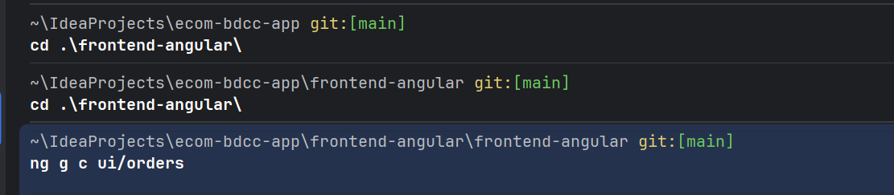

Le composant appelle `http://localhost:8088/api/orders` : sans l'intercepteur qui transmet le token, la requête échoue avec 401.

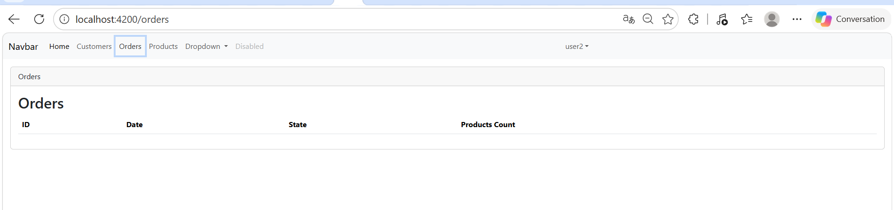

Une fois l'intercepteur Keycloak et le token transmis correctement, la liste des commandes s'affiche avec le nombre de produits de chaque commande.

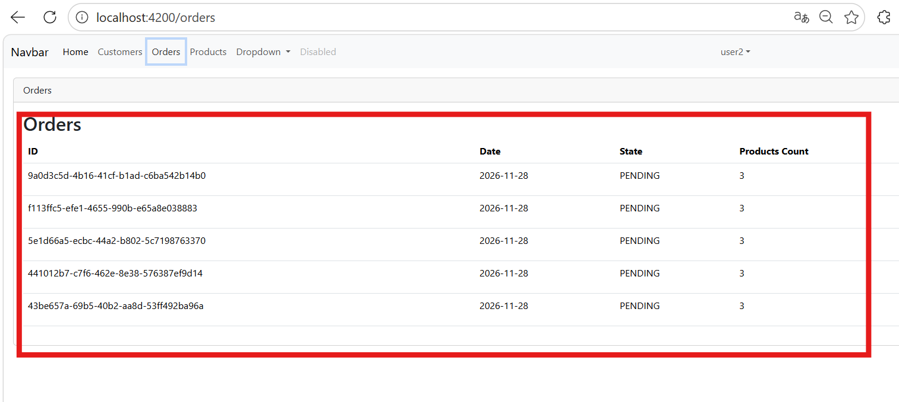

Les produits eux-mêmes s'affichent aussi, car l'appel vers l'inventaire transmet le token :

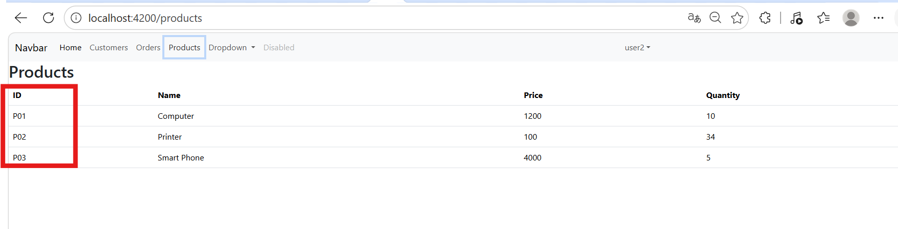

Un bouton **Order Details** ouvre la page de détail (`/order-details/:id`), protégée par le guard. Cette page affiche la date, l'état, les produits, les prix, les quantités et le total :

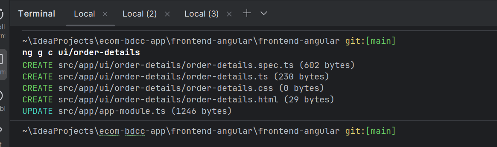

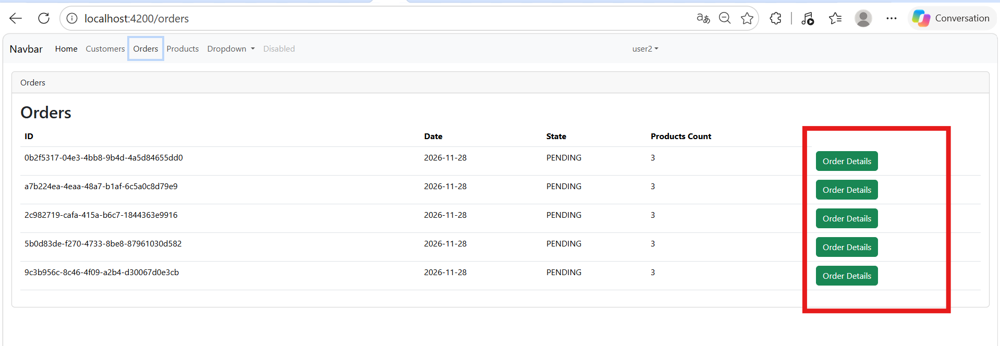

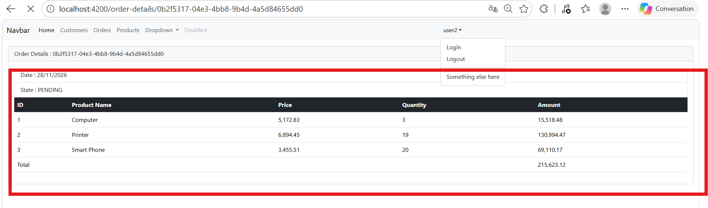

---

## 4. Difficultés rencontrées et solutions

Cette section regroupe les erreurs rencontrées pendant la mise en place. Chacune illustre un mécanisme important de la sécurité.

| Erreur observée | Cause réelle | Solution |
|---|---|---|
| `Address already in use: 8080` | Jenkins occupe le port 8080 | Lancer Keycloak sur `8180` avec `--http-port=8180` |
| `unauthorized_client` dans Postman | Direct access grants désactivé | Cocher **Direct access grants** sur le client |
| `Failed to fetch` / CORS sur `/token` | Origine `localhost:4200` absente de **Web origins** | Renseigner Web origins et Valid redirect URIs du client |
| `401` sur `/api/products` avec un token | Token expiré (durée de vie de 5 minutes) ou `jwk-set-uri` incorrect | Redemander un token ; vérifier le port et le realm dans `jwk-set-uri` |
| `403` avec un token valide | Casse des rôles : Keycloak envoie `ADMIN`, la règle teste `admin` | Utiliser les rôles en majuscules dans `hasAuthority` |
| Liste produits vide, pseudo affiché après un clic | Mise à jour faite hors de la zone Angular (promesses Keycloak) | Utiliser `NgZone.run(...)` pour mettre à jour les données |
| `Table "ORDER" not found` | `order` est un mot réservé SQL | Nommer la table `orders` avec `@Table(name = "orders")` |
| `401` au démarrage d'order-service | Appel vers l'inventaire au démarrage, sans token | Utiliser des identifiants fixes (`P01`, `P02`, `P03`) et ne pas appeler l'inventaire au démarrage |
| `Produit introuvable : P01` | La base de l'inventaire contenait des UUID aléatoires | Créer les produits avec les identifiants fixes `P01`, `P02`, `P03` |
| `ClassCastException: AnonymousAuthenticationToken` | Route `/api/orders` en `permitAll()`, donc requête anonyme | Retirer la route de `permitAll()` ; utiliser `instanceof` dans l'intercepteur |
| `500` sur `/api/orders` | Feign reçoit un 403 de l'inventaire, non géré par le contrôleur | Corriger la casse des rôles dans l'inventaire |
| `Can't configure anyRequest after itself` | Deux appels `authorizeHttpRequests` contenant chacun `anyRequest()` | Garder un seul bloc `authorizeHttpRequests`, avec `anyRequest()` en dernier |
| `401` dans le navigateur après un copier-coller du bloc `permitAll` | Une route était à la fois publique et protégée dans deux blocs | Une seule règle par route, dans un seul bloc |
| `401` dans Angular sur `/api/orders` | L'intercepteur Feign ne transmet pas le token, ou la requête Angular n'a pas le header | Vérifier `enableBearerInterceptor` côté Angular et l'intercepteur Feign côté backend |

---

## 5. Vérification finale

Le scénario complet a été vérifié dans cet ordre : démarrage de Keycloak, de `inventory-service` (8087), de `order-service` (8088), puis d'Angular (4200). Après connexion avec `user2`, la liste des produits, la liste des commandes et le détail d'une commande s'affichent. Avec `user1`, les commandes restent accessibles, tandis que les produits sont refusés.

Pour vérifier le trafic, l'onglet **Réseau** des outils de développement (F12) permet de contrôler que la requête `GET /api/orders` contient bien l'en-tête `Authorization: Bearer ...`.

---

## 6. Points à retenir

**Le token est la clé de tout.** Keycloak délivre le JWT, les services le vérifient avec la clé publique, et chaque appel entre services doit transmettre ce même token. Oublier une seule étape casse toute la chaîne.

**401 et 403 n'ont pas le même sens.** Le 401 signifie « je ne sais pas qui vous êtes » (token absent, invalide ou expiré). Le 403 signifie « je sais qui vous êtes, mais vous n'avez pas le droit ».

**Les rôles sont sensibles à la casse.** Dans ce projet, Keycloak renvoie `ADMIN` et `USER`, et les règles doivent utiliser exactement ces valeurs.

**La sécurité côté frontend est une aide, pas une protection.** Masquer un lien ou protéger une route dans Angular ne protège rien : seul le backend fait autorité.

**Les routes publiques doivent être volontaires.** Une route en `permitAll()` est accessible sans token, y compris par un appel qui en a besoin en aval. Chaque règle doit être vérifiée.

**Les tokens et secrets ne se partagent pas.** Un access token copié dans un document reste utilisable jusqu'à son expiration. Les secrets de client doivent rester côté serveur, et jamais dans une application Angular.

---

## 7. Pour la suite

Les prochaines étapes du cours, et les améliorations recommandées, sont :

- créer une couche **service** et des **DTO** pour séparer les entités des réponses JSON ;
- ajouter **Spring Cloud Gateway**, **Eureka Discovery** et **Config Server** pour finaliser l'architecture microservices ;
- remplacer les URL écrites en dur (`localhost:8087`) par le nom des services dans Feign ;
- personnaliser le thème de la page de connexion Keycloak ;
- configurer des identity providers (Google, GitHub, Facebook).