# Guide Keycloak : étapes du cours

Ce guide reprend, dans l'ordre, les étapes montrées par le professeur dans la vidéo : installation de Keycloak, création d'un realm, d'un client, de rôles et d'utilisateurs, test de l'authentification, puis OTP et politique de mots de passe.

---

## 0. Contexte

- **Keycloak** est un serveur d'identité et d'accès open source (authentification, SSO, gestion des utilisateurs, rôles, tokens).
- Il est développé avec le framework **Quarkus**, qui est en concurrence avec Spring. L'interface d'administration est une application Angular.
- Le professeur utilise la **version 26**. Chaque nouvelle version corrige souvent une faille de sécurité, il faut donc mettre à jour régulièrement.

---

## 1. Télécharger et démarrer Keycloak

1. Télécharger l'archive de Keycloak (version 26) sur le site officiel,
   https://www.keycloak.org/downloads on elchrage

 
puis la décompresser.


2. Ouvrir un terminal dans le dossier `bin` :

    - Linux / Mac :
      ```bash
      ./kc.sh start-dev
      ```
    - Windows :
      ```bat
      kc.bat start-dev
      ```

3. Ouvrir le navigateur sur **http://localhost:8100**.

### Créer l'administrateur

Avec la version 26, l'administrateur initial se crée avec des variables d'environnement, avant le démarrage :
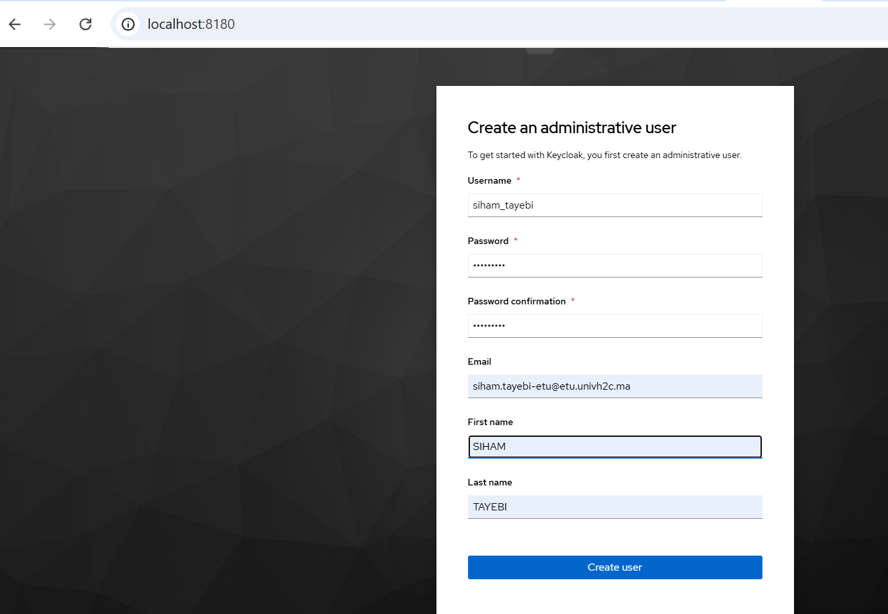

Se connecter ensuite à la console d'administration avec `siham_tayebi` / `admin`.


---

## 2. Créer un Realm

- Un **realm** est le territoire à sécuriser : l'ensemble des applications, utilisateurs, rôles et clients qui partagent la même identité.
- Un realm peut couvrir un projet ou plusieurs projets.

Étapes :

1. Dans le menu déroulant en haut à gauche (realm courant, par défaut *master*), cliquer sur **Create realm**.
2. Nom : **`enset-bdcc-realme`**.
3. Créer. Le realm `enset-bdcc-realme` est alors sélectionné.

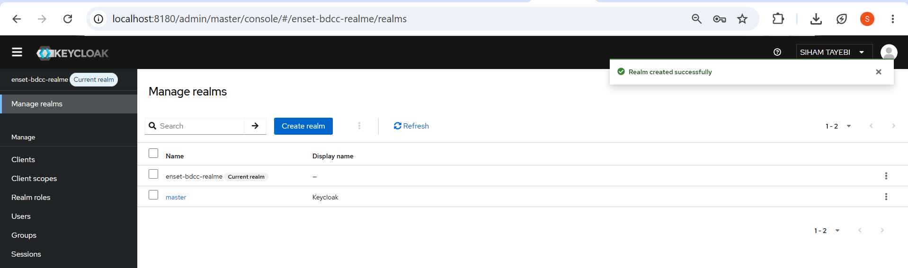
---

## 3. Créer un client

- Un **client** représente une application (chaque frontend ou backend qui doit s'authentifier auprès de Keycloak).

Étapes :

1. Dans le realm `enset-bdcc-realme` : menu **Clients** > **Create client**.
2. **Client ID** : `app-test`.
3. Laisser les paramètres par défaut, puis **Next** puis **Save**.
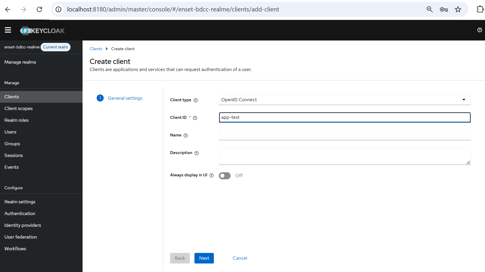


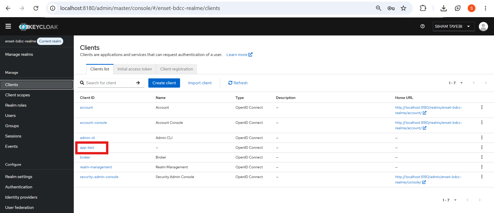
> **Important :** dans les paramètres du client, le champ **Web origins** (et les Valid redirect URIs) doit contenir le domaine du frontend, par exemple `http://localhost:4200`. Sinon les appels depuis le frontend seront bloqués. Pour ce test, on ne crée pas encore d'application.

---

## 4. Créer des rôles

Dans le realm `bdcc` : **Realm roles** > **Create role**.

1. Créer le rôle **`user`** puis **Save**.
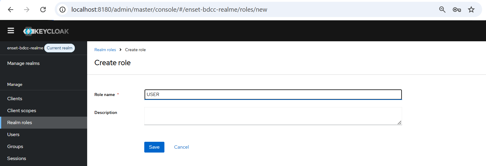
2. Créer le rôle **`admin`** puis **Save**.
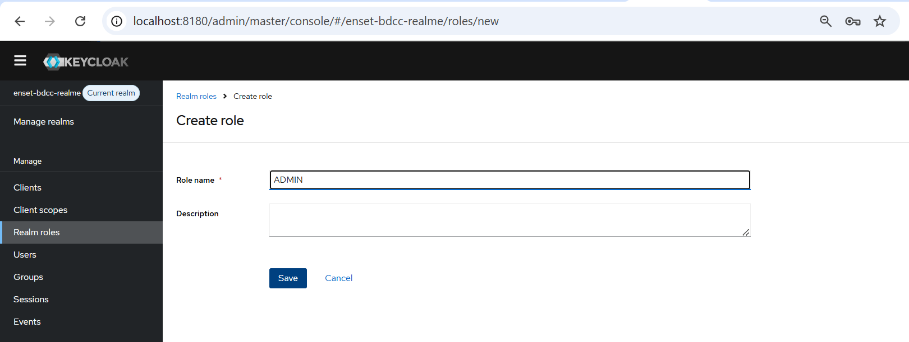
ce seno n bein ajoyute'

---

## 5. Créer des utilisateurs

Dans le realm `bdcc` : **Users** > **Create new user**.

**Utilisateur 1**
- Username : `user1`
- Email : `user1@example.com`
- First name : `siham` 
- Last name : au choix
- **Create**, puis onglet **Credentials** > **Set password** :
    - Mot de passe : `1234`
 
  - **Temporary** : désactivé (pour pouvoir tester directement, sinon l'utilisateur doit changer son mot de passe à la première connexion)

**Utilisateur 2**
- Username : `user2`
- Email : `user2@example.com`
- Mot de passe : `1234`, **Temporary** désactivé
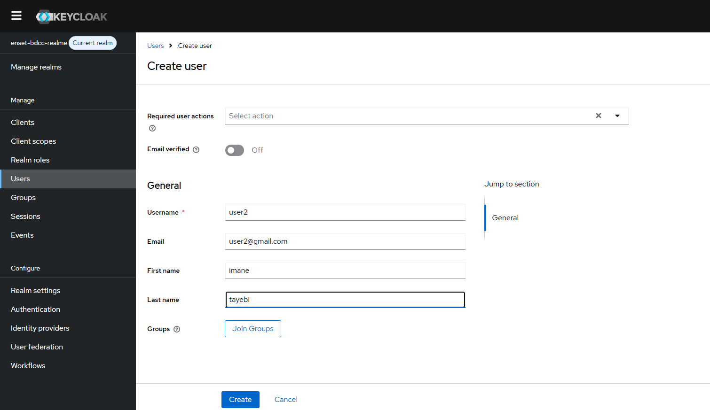

---

## 6. Affecter les rôles aux utilisateurs

1. Ouvrir **user1** > onglet **Role mapping** > **Assign role** > sélectionner **`user`**.


3. Ouvrir **user2** > onglet **Role mapping** > **Assign role** > sélectionner **`user`** et **`admin`**.
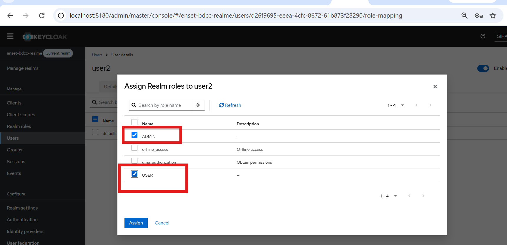

---

## 7. Tester l'authentification avec un mot de passe (Grant type `password`)

### Trouver l'adresse du token endpoint

1. Dans le realm `bdcc` : **Realm settings** > **General** / section **Endpoints** > **OpenID Endpoint Configuration**.
2. Repérer le `token_endpoint`. Il ressemble à :

   ```
   http://localhost:8100/realms/bdcc/protocol/openid-connect/token
   ```

### Envoyer la requête (Postman ou IntelliJ HTTP Client)

- **Méthode :** `POST`
- **URL :** l'adresse du token endpoint ci-dessus
- **Header :** `Content-Type: application/x-www-form-urlencoded`

- **Body (x-www-form-urlencoded)** :

| Clé | Valeur |
|---|---|
| `grant_type` | `password` |
| `username` | `user1` |
| `password` | `1234` |
| `client_id` | `app-test` |

mais on fait direkc acces garnts pour pouvoir se connetcrerdepus postamn

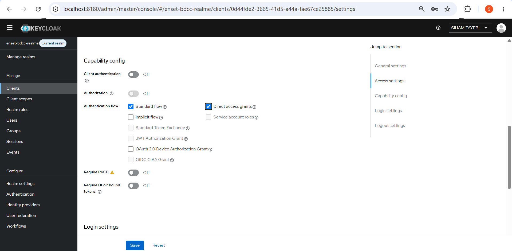
### Résultat

La réponse JSON contient :
- **`access_token`** : expire par défaut au bout de **300 secondes** (5 minutes).
- **`refresh_token`** : expire par défaut au bout de **1800 secondes** (30 minutes).
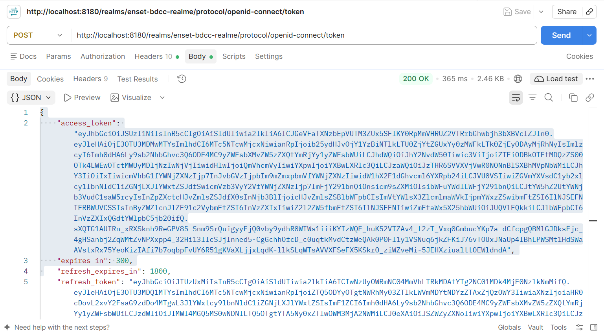
### Inspecter le token

Copier l'`access_token` sur **https://jwt.io** pour voir son contenu :
- `exp` : date d'expiration
- `iat` : date de création
- `sub` : identifiant de l'utilisateur authentifié
- `realm_access` : les rôles de l'utilisateur (ici `user`)
- `given_name`, `family_name`, `email` : informations de profil, ajoutées par défaut
- Signature en **RS256** (le token de rafraîchissement est, lui, signé en HMAC et ne contient ni rôles ni profil)


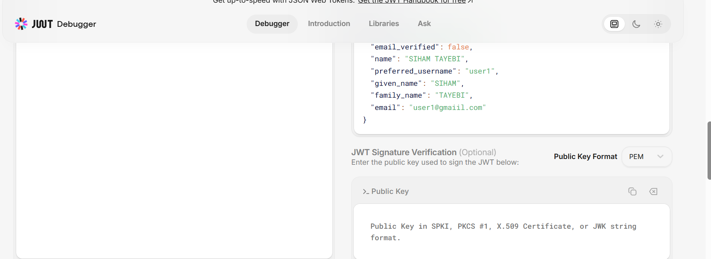
---

## 8. Renouveler le token (Grant type `refresh_token`)

Même URL et même header que précédemment, avec ces paramètres :

| Clé | Valeur |
|---|---|
| `grant_type` | `refresh_token` |
| `refresh_token` | le refresh token reçu à l'étape 7 |
| `client_id` | `app-test` |

Keycloak renvoie un **nouvel access token** et un **nouveau refresh token**.

Cas d'usage du cours : une application mobile stocke le token de façon sécurisée et l'utilise pour accéder au backend.

---

## 9. Authentification client credentials (Grant type `client_credentials`)

Utile pour la communication **service à service** (un backend qui appelle un autre backend), sans utilisateur.

### Activer le client secret

1. Ouvrir le client **app-test** > onglet **Settings**.
2. Dans la section **Capability config** : activer **Client authentication**, puis cocher **Service accounts roles**.
3. **Save**.
4. Onglet **Credentials** : copier le **Client secret**.


### Envoyer la requête

| Clé | Valeur |
|---|---|
| `grant_type` | `client_credentials` |
| `client_id` | `app-test` |
| `client_secret` | le secret copié |

Le token est renvoyé, sans username ni mot de passe.

> **Piège du cours :** une fois le client secret activé, le grant `password` ne fonctionne plus avec le seul `client_id`. Il faut ajouter `client_secret` à la requête, sinon la requête est refusée.

---

## 10. Options de configuration à connaître

### Login (onglet *Realm settings* > *Login*)
- **User registration** : affiche un lien d'inscription sur la page de connexion.
- **Forgot password** : formulaire de réinitialisation du mot de passe.
- **Remember me**, **Email as username** (connexion avec l'email ou le username), **Login with email**.
- **Verify email** : vérification de l'adresse email.

### Thèmes
- La page de connexion est fournie par défaut, mais on peut définir un **thème personnalisé** (*Realm settings* > *Themes*).

### User Federation
- Permet de déléguer la gestion des identités à un annuaire existant, par exemple **LDAP** ou **Active Directory**, quand l'entreprise centralise déjà ses utilisateurs.

### Identity Providers
- Permet de déléguer l'authentification à un fournisseur externe : **GitHub, Google, Facebook, Twitter**, etc. Il suffit de cocher la case et de renseigner les identifiants du fournisseur.

---

## 11. Double authentification (OTP)

### Activer l'OTP pour un utilisateur

1. **Users** > **user1** > section **Required user actions**.
2. Sélectionner **Configure OTP** puis **Save**.

### Première connexion

1. Se connecter avec `user1` / `1234`.
2. Une page affiche un **QR code**.
3. Scanner le QR code avec une application comme **Google Authenticator**, **Microsoft Authenticator** ou **FreeOTP**.
4. Saisir le code à 6 chiffres affiché par l'application.

### Principe (expliqué par le professeur)

- Keycloak et l'application mobile n'échangent **aucune donnée** pendant l'utilisation.
- Le QR code transmet la **clé secrète partagée**, le nom du realm et les paramètres (algorithme, période).
- À partir de la même clé et de l'heure, les deux côtés calculent le **même code** à chaque période. C'est le principe **TOTP** (*Time-based One-Time Password*).
- Le professeur indique une période de 15 secondes ; la valeur par défaut de Keycloak est de 30 secondes. Elle est configurable dans les paramètres OTP du realm.

---

## 12. Politique de mots de passe

Dans **Authentication** > **Policies** > **Password policy**, on peut ajouter des règles :

- **Expiration** : le mot de passe expire au bout de 365 jours (exemple du cours).
- **Not recently used** : interdit de réutiliser un ancien mot de passe (nombre de mémorisation à définir).
- **Length** : longueur minimale.
- **Uppercase / Lowercase / Digits / Special characters** : nombre minimal de caractères de chaque type.
- **Not username** : le mot de passe ne doit pas contenir le nom d'utilisateur.
- **Maximum length** : longueur maximale.

Ces règles s'appliquent dès l'inscription ou au changement de mot de passe. Le professeur rappelle qu'il ne faut jamais laisser les utilisateurs choisir n'importe quel mot de passe.

---

## 13. Pour la suite

Le prochain cours (disponible sur Classroom) montrera :
- Créer une application **backend Spring** et un **frontend Angular**.
- Sécuriser le backend avec **Spring Security** et **Keycloak**.
- Sécuriser le frontend avec Keycloak.

---

## Récapitulatif rapide

| Étape | Où | Action |
|---|---|---|
| 1 | Terminal | `kc.sh start-dev` puis admin via variables d'environnement |
| 2 | Console | Créer le realm `bdcc` |
| 3 | Clients | Créer le client `app-test` |
| 4 | Realm roles | Créer `user` et `admin` |
| 5 | Users | Créer `user1` (mdp `1234`) et `user2` (mdp `1234`) |
| 6 | Role mapping | `user1` : user ; `user2` : user + admin |
| 7 | Postman | `grant_type=password` sur le token endpoint |
| 8 | Postman | `grant_type=refresh_token` |
| 9 | Client `app-test` | Client authentication + Service accounts, puis `client_credentials` |
| 10 | Login / Thèmes / Federation / IdP | Options à explorer |
| 11 | User1 | Required user action : Configure OTP |
| 12 | Authentication > Policies | Password policy |


Partie2:Sécuriser une architecture  micro-service Spring Angular avec Keycloak :  
on crer invntory sevri e:
# Guide 2 : sécuriser un backend Spring Boot et un frontend Angular avec Keycloak

Ce guide reprend, dans l'ordre, les étapes montrées par le professeur dans la deuxième partie : création du microservice `inventory-service`, mise en place de la sécurité Spring, création du frontend Angular, intégration de Keycloak (authentification, rôles, protection des routes), puis options avancées.

> **Prérequis :** avoir suivi le guide 1 (Keycloak installé, realm `bdcc`, rôles `user` et `admin`, utilisateurs `user1` et `user2`).

---

## 0. Architecture visée

```
Navigateur (Angular :4200)  --->  Keycloak (:8080)   [login, tokens]
        |
        | requête HTTP + header Authorization: Bearer <JWT>
        v
inventory-service (Spring Boot :8087)  --->  vérifie la signature du JWT via la clé publique de Keycloak
```


- **Keycloak** authentifie l'utilisateur et délivre un JWT.
- **Angular** (frontend) redirige vers Keycloak pour la connexion, puis envoie le JWT à chaque requête.
- **Spring Boot** (backend) vérifie le JWT et applique les règles d'accès selon les rôles.

 > **Port Keycloak :** dans ce guide, Keycloak est sur `http://localhost:8080`. Si Jenkins occupe ce port, lancez Keycloak sur `8180` (`kc.bat start-dev --http-port=8180`) et remplacez `8080` par `8180` partout (`application.properties`, Angular, Postman).

---

## 1. Créer le projet et le microservice Spring Boot

### 1.1 Projet parent

1. Créer un projet **Maven** nommé `ecom-bdcc-app` (groupe `ma.enset`, artifact `ecom-bdcc-app`, par exemple).

### 1.2 Module inventory-service

1. Clic droit sur le projet > **New** > **Module** > **Spring Initializr**.
2. Paramètres :
    - Name : `inventory-service`
    - Java : **21**
    - Spring Boot : **3.2.2**
3. Dépendances :
    - **Spring Web**
    - **Spring Data JPA**
    - **H2 Database**
    - **Lombok**
    - **Eureka Discovery Client** (`spring-cloud-starter-netflix-eureka-client`)
    - **Config Client** (`spring-cloud-starter-config`)
    - **OAuth2 Resource Server** (`spring-boot-starter-oauth2-resource-server`)

> Les dépendances Spring Cloud (Eureka, Config) sont présentes pour l'architecture microservices. Elles seront désactivées dans `application.properties` pour ce test. Si Maven signale un conflit de version, utilisez le BOM Spring Cloud compatible avec Spring Boot 3.2 (série `2023.0.x`).

> **Pourquoi OAuth2 Resource Server ?** Cette dépendance permet à un microservice de vérifier des tokens OpenID Connect (JWT) émis par Keycloak. Il est recommandé pour les backends.

---

## 2. Créer les entités, le repository et les données de test

Structure des packages dans `inventory-service` :

```
src/main/java/com/example/inventoryservice/
├── entities/
├── repositories/
├── web/
├── security/
└── InventoryServiceApplication.java
```

### 2.1 Entité `Product`

`entities/Product.java`

```java
package com.example.inventoryservice.entities;

import jakarta.persistence.Entity;
import jakarta.persistence.Id;
import lombok.AllArgsConstructor;
import lombok.Builder;
import lombok.Getter;
import lombok.NoArgsConstructor;
import lombok.Setter;

@Entity
@Getter
@Setter
@Builder
@NoArgsConstructor
@AllArgsConstructor
public class Product {
    @Id
    private String id;
    private String name;
    private double price;
    private int quantity;
}
```

> Le professeur utilisait `@Data`, mais signalait des soucis selon les versions. `@Getter` et `@Setter` évitent ce problème.

### 2.2 Repository

`repositories/ProductRepository.java`

```java
package com.example.inventoryservice.repositories;

import com.example.inventoryservice.entities.Product;
import org.springframework.data.jpa.repository.JpaRepository;

public interface ProductRepository extends JpaRepository<Product, String> {
}
```

### 2.3 Données de test avec `CommandLineRunner`

`InventoryServiceApplication.java`

```java
package com.example.inventoryservice;

import com.example.inventoryservice.entities.Product;
import com.example.inventoryservice.repositories.ProductRepository;
import org.springframework.boot.CommandLineRunner;
import org.springframework.boot.SpringApplication;
import org.springframework.boot.autoconfigure.SpringBootApplication;
import org.springframework.context.annotation.Bean;

import java.util.UUID;

@SpringBootApplication
public class InventoryServiceApplication {

    public static void main(String[] args) {
        SpringApplication.run(InventoryServiceApplication.class, args);
    }

    @Bean
    CommandLineRunner start(ProductRepository productRepository) {
        return args -> {
            productRepository.save(Product.builder()
                    .id(UUID.randomUUID().toString())
                    .name("Computer")
                    .price(1200)
                    .quantity(10)
                    .build());
            productRepository.save(Product.builder()
                    .id(UUID.randomUUID().toString())
                    .name("Printer")
                    .price(100)
                    .quantity(34)
                    .build());
            productRepository.save(Product.builder()
                    .id(UUID.randomUUID().toString())
                    .name("Smart Phone")
                    .price(4000)
                    .quantity(5)
                    .build());
        };
    }
}
```

> **Explication du professeur :** `CommandLineRunner` est une interface à une seule méthode `run`. Spring exécute automatiquement cette méthode au démarrage, dès qu'il trouve un bean de ce type. La version avec lambda est équivalente à une classe qui implémente l'interface.
>
> **Pourquoi `UUID` ?** Le champ `id` est une `String` et non un entier auto-incrémenté. Il faut donc fournir la valeur soi-même. Les valeurs de prix et de quantité sont des exemples, la vidéo est peu claire sur ces chiffres.

### 2.4 Configuration

`src/main/resources/application.properties`

```properties
server.port=8087
spring.application.name=inventory-service

spring.datasource.url=jdbc:h2:mem:product-db
spring.h2.console.enabled=true

# Désactivation de Config Server et de Discovery pour ce test
spring.cloud.config.enabled=false
spring.cloud.discovery.enabled=false

# Clé publique de Keycloak pour vérifier la signature des JWT
spring.security.oauth2.resourceserver.jwt.jwk-set-uri=http://localhost:8080/realms/bdcc/protocol/openid-connect/certs
```

---

## 3. Créer le contrôleur REST

`web/ProductController.java`

```java
package com.example.inventoryservice.web;

import com.example.inventoryservice.entities.Product;
import com.example.inventoryservice.repositories.ProductRepository;
import org.springframework.security.core.Authentication;
import org.springframework.web.bind.annotation.GetMapping;
import org.springframework.web.bind.annotation.PathVariable;
import org.springframework.web.bind.annotation.RequestMapping;
import org.springframework.web.bind.annotation.RestController;

import java.util.List;

@RestController
@RequestMapping("/api")
public class ProductController {

    private final ProductRepository productRepository;

    // Injection par constructeur (bonne pratique)
    public ProductController(ProductRepository productRepository) {
        this.productRepository = productRepository;
    }

    @GetMapping("/products")
    public List<Product> productList() {
        return productRepository.findAll();
    }

    @GetMapping("/products/{id}")
    public Product productById(@PathVariable String id) {
        return productRepository.findById(id)
                .orElseThrow(() -> new RuntimeException("Produit introuvable : " + id));
    }

    // Endpoint de test : affiche le contexte de sécurité (Authentication)
    @GetMapping("/auth")
    public Authentication authentication(Authentication authentication) {
        return authentication;
    }
}
```

---

## 4. Premier test sans sécurité

Démarrez `inventory-service`, puis ouvrez `http://localhost:8087/api/products`.

Résultat attendu : **401** ou page de connexion. Spring Security, par défaut, protège **toutes** les routes et demande une authentification.

---

## 5. Configuration de Spring Security (étape par étape)

### 5.1 Première configuration : tout autoriser

Le professeur conseille de commencer avec une configuration qui autorise tout, afin de développer le frontend sans bloquer. On sécurisera ensuite.

`security/SecurityConfig.java` (version initiale)

```java
package com.example.inventoryservice.security;

import org.springframework.context.annotation.Bean;
import org.springframework.context.annotation.Configuration;
import org.springframework.security.config.annotation.web.builders.HttpSecurity;
import org.springframework.security.config.annotation.web.configuration.EnableWebSecurity;
import org.springframework.security.web.SecurityFilterChain;

@Configuration
@EnableWebSecurity
public class SecurityConfig {

    @Bean
    SecurityFilterChain securityFilterChain(HttpSecurity http) throws Exception {
        http.csrf(csrf -> csrf.disable())
            .authorizeHttpRequests(ar -> ar
                .requestMatchers("/api/**").permitAll()
                .anyRequest().authenticated());
        return http.build();
    }
}
```

> **CSRF :** la protection CSRF est utile pour les sessions (stateful). Ici l'authentification est stateless (JWT), donc on la désactive. Sans cela, les requêtes POST recevraient une erreur **403**.

### 5.2 Erreurs courantes à comprendre

| Code | Signification dans ce cours |
|---|---|
| **401** | Non authentifié : aucun token, ou token invalide ou expiré |
| **403** | Authentifié, mais sans le droit (rôle insuffisant), ou CSRF non désactivé |

### 5.3 Autoriser la console H2

La console H2 utilise des frames HTML. Spring Security les refuse par défaut.

Dans `SecurityConfig`, ajoutez :

```java
http.csrf(csrf -> csrf.disable())
    .headers(headers -> headers.frameOptions(frame -> frame.disable()))
    .authorizeHttpRequests(ar -> ar
        .requestMatchers("/h2-console/**").permitAll()
        .requestMatchers("/api/**").permitAll()
        .anyRequest().authenticated());
```

Ouvrez ensuite `http://localhost:8087/h2-console`, JDBC URL : `jdbc:h2:mem:product-db`.

---

## 6. Configuration CORS

Sans CORS, le navigateur bloque les requêtes d'Angular (`localhost:4200`) vers Spring (`localhost:8087`). L'erreur apparaît dans les outils de développement : *blocked by CORS policy*.

Le professeur montre d'abord une solution rapide : `@CrossOrigin(origins = "*")` sur le contrôleur. Il précise que **ce n'est pas la bonne solution**, car elle ne fonctionne pas sur les endpoints protégés par Spring Security. La solution recommandée est un bean `CorsConfigurationSource`, qui est utilisé par la chaîne de sécurité.

Ajoutez dans `SecurityConfig` :

```java
import org.springframework.security.config.Customizer;
import org.springframework.web.cors.CorsConfiguration;
import org.springframework.web.cors.CorsConfigurationSource;
import org.springframework.web.cors.UrlBasedCorsConfigurationSource;
import java.util.List;

@Bean
CorsConfigurationSource corsConfigurationSource() {
    CorsConfiguration config = new CorsConfiguration();
    // Pour le cours : "*". En production, indiquez uniquement l'origine du frontend.
    config.setAllowedOrigins(List.of("*"));
    config.setAllowedMethods(List.of("*"));
    config.setAllowedHeaders(List.of("*"));
    config.setExposedHeaders(List.of("*"));

    UrlBasedCorsConfigurationSource source = new UrlBasedCorsConfigurationSource();
    source.registerCorsConfiguration("/**", config);
    return source;
}
```

Et dans la chaîne de filtres :

```java
http.cors(Customizer.withDefaults())
```

> En production, remplacez `List.of("*")` par `List.of("http://localhost:4200")`.

---

## 7. Sécuriser avec Keycloak (JWT et rôles)

### 7.1 Le convertisseur de rôles

Par défaut, Spring lit les autorités dans le claim `scope`. Keycloak place les rôles dans un claim `realm_access`, sous la clé `roles`. Il faut donc un convertisseur personnalisé.

`security/KeycloakJwtConverter.java`

```java
package com.example.inventoryservice.security;

import org.springframework.core.convert.converter.Converter;
import org.springframework.security.authentication.AbstractAuthenticationToken;
import org.springframework.security.core.GrantedAuthority;
import org.springframework.security.core.authority.SimpleGrantedAuthority;
import org.springframework.security.oauth2.jwt.Jwt;
import org.springframework.security.oauth2.server.resource.authentication.JwtAuthenticationToken;
import org.springframework.security.oauth2.server.resource.authentication.JwtGrantedAuthoritiesConverter;
import org.springframework.stereotype.Component;

import java.util.Collection;
import java.util.List;
import java.util.Map;
import java.util.Set;
import java.util.stream.Collectors;
import java.util.stream.Stream;

@Component
public class KeycloakJwtConverter implements Converter<Jwt, AbstractAuthenticationToken> {

    private final JwtGrantedAuthoritiesConverter defaultConverter = new JwtGrantedAuthoritiesConverter();

    @Override
    public AbstractAuthenticationToken convert(Jwt jwt) {
        Set<GrantedAuthority> authorities = Stream.concat(
                        defaultConverter.convert(jwt).stream(),
                        extractRealmRoles(jwt).stream())
                .collect(Collectors.toSet());
        return new JwtAuthenticationToken(jwt, authorities);
    }

    @SuppressWarnings("unchecked")
    private Collection<? extends GrantedAuthority> extractRealmRoles(Jwt jwt) {
        Map<String, Object> realmAccess = jwt.getClaim("realm_access");
        if (realmAccess == null || realmAccess.get("roles") == null) {
            return List.of();
        }
        Collection<String> roles = (Collection<String>) realmAccess.get("roles");
        return roles.stream()
                .map(SimpleGrantedAuthority::new)
                .collect(Collectors.toList());
    }
}
```

> **Explication :** le convertisseur lit le claim `realm_access.roles` du JWT, par exemple `["user", "admin"]`, et crée une autorité Spring pour chaque rôle. Les rôles sont donc utilisés **sans préfixe** `ROLE_` : on vérifiera avec `hasAuthority("admin")`.

### 7.2 Règles d'accès finales

Mettez à jour `SecurityConfig` :

```java
package com.example.inventoryservice.security;

import org.springframework.context.annotation.Bean;
import org.springframework.context.annotation.Configuration;
import org.springframework.security.config.Customizer;
import org.springframework.security.config.annotation.web.builders.HttpSecurity;
import org.springframework.security.config.annotation.web.configuration.EnableWebSecurity;
import org.springframework.security.web.SecurityFilterChain;
import org.springframework.web.cors.CorsConfiguration;
import org.springframework.web.cors.CorsConfigurationSource;
import org.springframework.web.cors.UrlBasedCorsConfigurationSource;

import java.util.List;

@Configuration
@EnableWebSecurity
public class SecurityConfig {

    private final KeycloakJwtConverter keycloakJwtConverter;

    public SecurityConfig(KeycloakJwtConverter keycloakJwtConverter) {
        this.keycloakJwtConverter = keycloakJwtConverter;
    }

    @Bean
    SecurityFilterChain securityFilterChain(HttpSecurity http) throws Exception {
        http
            .csrf(csrf -> csrf.disable())
            .headers(headers -> headers.frameOptions(frame -> frame.disable()))
            .cors(Customizer.withDefaults())
            .authorizeHttpRequests(ar -> ar
                .requestMatchers("/h2-console/**").permitAll()
                .requestMatchers("/api/products").hasAuthority("admin")
                .requestMatchers("/api/products/**").hasAuthority("user")
                .anyRequest().authenticated())
            .oauth2ResourceServer(oauth2 -> oauth2
                .jwt(jwt -> jwt.jwtAuthenticationConverter(keycloakJwtConverter)));
        return http.build();
    }

    @Bean
    CorsConfigurationSource corsConfigurationSource() {
        CorsConfiguration config = new CorsConfiguration();
        config.setAllowedOrigins(List.of("*"));
        config.setAllowedMethods(List.of("*"));
        config.setAllowedHeaders(List.of("*"));
        config.setExposedHeaders(List.of("*"));

        UrlBasedCorsConfigurationSource source = new UrlBasedCorsConfigurationSource();
        source.registerCorsConfiguration("/**", config);
        return source;
    }
}
```

> **Règles :**
> - `GET /api/products` (liste complète) : rôle **admin** uniquement.
> - `GET /api/products/{id}` : rôle **user**.
> - Tout le reste : être authentifié.
>
> Le professeur précise que l'autorisation peut aussi se faire par annotation, avec `@EnableMethodSecurity` et `@PreAuthorize("hasAuthority('admin')")` sur la méthode du contrôleur.

Redémarrez le service.

---

## 8. Tester le backend avec Postman

### 8.1 Activer le Direct Access Grants (si besoin)

Pour que la requête `password` fonctionne, le client doit autoriser le grant. Dans Keycloak : **Clients > app-test > Settings > Capability config > Direct access grants** (coché) > **Save**.

Si le client a **Client authentication** activé, la requête doit aussi contenir `client_secret`.

### 8.2 Obtenir un token

- **Méthode :** `POST`
- **URL :** `http://localhost:8080/realms/bdcc/protocol/openid-connect/token`
- **Header :** `Content-Type: application/x-www-form-urlencoded`
- **Body :**

| Clé | Valeur |
|---|---|
| `grant_type` | `password` |
| `username` | `user2` |
| `password` | `1234` |
| `client_id` | `app-test` |

Copiez la valeur de `access_token`.

### 8.3 Appeler le backend

Dans Postman, onglet **Headers** :

```
Authorization: Bearer <access_token>
```

Testez :

| Requête | user1 (rôle user) | user2 (rôles user + admin) |
|---|---|---|
| `GET /api/products` | 403 | 200 |
| `GET /api/products/{id}` | 200 | 200 |
| `GET /api/auth` | 200 (affiche l'authentification) | 200 |

Sans header `Authorization`, la réponse est **401**.

> Dans `/api/auth`, vérifiez la section `authorities` : elle doit contenir `user` et `admin` pour `user2`.

---

## 9. Créer le frontend Angular

### 9.1 Générer le projet dans le dossier courant

Créez un dossier `app-angular`, ouvrez-le dans un terminal, puis :

```bash
ng new app-angular --directory ./ --no-standalone --style=css --ssr=false --routing
```

> Le professeur utilise `--no-standalone` pour rester sur l'approche avec modules (NgModule), plus proche de l'ancien fonctionnement d'Angular. Il est possible d'utiliser le mode standalone, mais le code sera différent.

### 9.2 Installer Bootstrap

```bash
npm install bootstrap bootstrap-icons
```

Dans `angular.json`, section `build > options` :

```json
"styles": [
  "node_modules/bootstrap/dist/css/bootstrap.min.css",
  "src/styles.css"
],
"scripts": [
  "node_modules/bootstrap/dist/js/bootstrap.bundle.js"
]
```

### 9.3 Générer les composants

```bash
ng g c ui/products
ng g c ui/customers
```

### 9.4 Routage

`src/app/app-routing.module.ts`

```ts
import { NgModule } from '@angular/core';
import { RouterModule, Routes } from '@angular/router';
import { ProductsComponent } from './ui/products/products.component';
import { CustomersComponent } from './ui/customers/customers.component';

const routes: Routes = [
  { path: 'products', component: ProductsComponent },
  { path: 'customers', component: CustomersComponent },
];

@NgModule({
  imports: [RouterModule.forRoot(routes)],
  exports: [RouterModule],
})
export class AppRoutingModule {}
```

> Les routes seront protégées avec un guard à l'étape 11.

### 9.5 Barre de navigation

`src/app/app.component.html` : remplacez le contenu par une barre de navigation Bootstrap (copiée d'un exemple, comme dans le cours) puis gardez uniquement :

```html
<nav class="navbar navbar-expand-lg bg-body-tertiary">
  <div class="container-fluid">
    <a class="navbar-brand" href="#">Ecom</a>
    <ul class="navbar-nav me-auto">
      <li class="nav-item">
        <a class="nav-link" routerLink="products">Products</a>
      </li>
      <li class="nav-item">
        <a class="nav-link" routerLink="customers">Customers</a>
      </li>
    </ul>
  </div>
</nav>

<div class="container mt-4">
  <router-outlet></router-outlet>
</div>
```

Lancez `ng serve` et ouvrez `http://localhost:4200`.

---

## 10. Afficher les produits (sans sécurité Angular)

### 10.1 Composant produits

`src/app/ui/products/products.component.ts`

```ts
import { Component, OnInit } from '@angular/core';
import { HttpClient } from '@angular/common/http';

@Component({
  selector: 'app-products',
  templateUrl: './products.component.html',
  styleUrls: ['./products.component.css'],
})
export class ProductsComponent implements OnInit {
  public products: any[] = [];

  constructor(private http: HttpClient) {}

  ngOnInit(): void {
    this.http.get<any[]>('http://localhost:8087/api/products').subscribe({
      next: (data) => (this.products = data),
      error: (err) => console.log(err),
    });
  }
}
```

`src/app/ui/products/products.component.html`

```html
<h2>Products</h2>
<table class="table">
  <thead>
    <tr>
      <th>ID</th>
      <th>Name</th>
      <th>Price</th>
      <th>Quantity</th>
    </tr>
  </thead>
  <tbody>
    <tr *ngFor="let p of products">
      <td>{{ p.id }}</td>
      <td>{{ p.name }}</td>
      <td>{{ p.price }}</td>
      <td>{{ p.quantity }}</td>
    </tr>
  </tbody>
</table>
```

Ajoutez `HttpClientModule` dans les `imports` de `app.module.ts`.

> **Problème de CORS :** si la liste ne s'affiche pas et que la console indique *blocked by CORS policy*, vérifiez que la configuration CORS (étape 6) est bien présente et que le service a bien redémarré.

---

## 11. Installer et configurer le client Keycloak pour Angular

### 11.1 Dans Keycloak : créer le client Angular

1. Realm **bdcc** > **Clients** > **Create client**.
2. **Client ID** : `app-ang`
3. **Next** : laisser **Client authentication** **désactivé** (client public, pas de secret pour un frontend).
4. **Login settings** :
    - **Valid redirect URIs** : `http://localhost:4200/*`
    - **Web origins** : `http://localhost:4200`
5. **Save**.

> **Important :** ne pas activer **Client authentication** pour le frontend. Le professeur montre que le client secret ne peut pas être utilisé dans une application Angular, car il serait visible dans le navigateur. Si vous l'avez activé pendant les tests, désactivez-le.

> **Recommandation actuelle (Keycloak 26) :** activez aussi **PKCE** dans l'onglet *Advanced* du client, avec **Proof Key for Code Exchange Code Challenge Method** = `S256`.

### 11.2 Installer les librairies

```bash
npm install keycloak-angular keycloak-js
```

### 11.3 Page de vérification silencieuse

Créez `src/assets/silent-check-sso.html` :

```html
<!doctype html>
<html>
  <body>
    <script>
      parent.postMessage(location.href, location.origin);
    </script>
  </body>
</html>
```

> Cette page permet à Keycloak de vérifier la session sans rediriger toute l'application (check-sso).

### 11.4 Initialisation dans `app.module.ts`

```ts
import { NgModule, APP_INITIALIZER } from '@angular/core';
import { BrowserModule } from '@angular/platform-browser';
import { HttpClientModule } from '@angular/common/http';
import { KeycloakAngularModule, KeycloakService } from 'keycloak-angular';

import { AppRoutingModule } from './app-routing.module';
import { AppComponent } from './app.component';
import { ProductsComponent } from './ui/products/products.component';
import { CustomersComponent } from './ui/customers/customers.component';

function initializeKeycloak(keycloak: KeycloakService) {
  return () =>
    keycloak.init({
      config: {
        url: 'http://localhost:8080',
        realm: 'bdcc',
        clientId: 'app-ang',
      },
      initOptions: {
        onLoad: 'check-sso',
        silentCheckSsoRedirectUri:
          window.location.origin + '/assets/silent-check-sso.html',
      },
      enableBearerInterceptor: true,
    });
}

@NgModule({
  declarations: [AppComponent, ProductsComponent, CustomersComponent],
  imports: [
    BrowserModule,
    AppRoutingModule,
    HttpClientModule,
    KeycloakAngularModule,
  ],
  providers: [
    {
      provide: APP_INITIALIZER,
      useFactory: initializeKeycloak,
      multi: true,
      deps: [KeycloakService],
    },
  ],
  bootstrap: [AppComponent],
})
export class AppModule {}
```

> **Explication du professeur :** `APP_INITIALIZER` exécute la fonction **avant** le démarrage de l'application. Elle initialise Keycloak et vérifie si l'utilisateur est déjà authentifié. `check-sso` affiche l'interface sans forcer la connexion. La redirection vers Keycloak n'a lieu que lorsqu'on accède à une route protégée.
>
> `enableBearerInterceptor: true` ajoute automatiquement le header `Authorization: Bearer <token>` à chaque requête HTTP.
>
> Les noms de paramètres peuvent changer selon la version de `keycloak-angular`. Vérifiez la documentation officielle de la version installée.

---

## 12. Protéger les routes avec un Guard

### 12.1 Générer le guard

```bash
ng g guard guards/auth
```

Choisissez `CanActivate` si Angular le demande.

### 12.2 Code du guard

`src/app/guards/auth.guard.ts`

```ts
import { Injectable } from '@angular/core';
import { ActivatedRouteSnapshot, RouterStateSnapshot, Router } from '@angular/router';
import { KeycloakAuthGuard, KeycloakService } from 'keycloak-angular';

@Injectable({ providedIn: 'root' })
export class AuthGuard extends KeycloakAuthGuard {
  constructor(
    protected override readonly router: Router,
    protected readonly keycloakAngular: KeycloakService
  ) {
    super(router, keycloakAngular);
  }

  public async isAccessAllowed(
    route: ActivatedRouteSnapshot,
    state: RouterStateSnapshot
  ): Promise<boolean> {
    // 1. L'utilisateur doit être authentifié
    if (!this.authenticated) {
      await this.keycloakAngular.login({
        // Après la connexion, Keycloak renvoie l'utilisateur sur la page demandée
        redirectUri: window.location.origin + state.url,
      });
      return false;
    }

    // 2. Rôles requis pour la route (définis dans route.data)
    const requiredRoles: string[] = route.data['roles'];

    // Pas de rôle requis : l'authentification suffit
    if (!requiredRoles || requiredRoles.length === 0) {
      return true;
    }

    // L'utilisateur doit posséder tous les rôles requis
    return requiredRoles.every((role) => this.roles.includes(role));
  }
}
```

> **Note :** le mot-clé `override` est nécessaire avec Angular 17 et versions suivantes, car l'attribut `router` est déjà déclaré dans la classe parente.

### 12.3 Protéger les routes

`src/app/app-routing.module.ts`

```ts
import { AuthGuard } from './guards/auth.guard';

const routes: Routes = [
  {
    path: 'products',
    component: ProductsComponent,
    canActivate: [AuthGuard],
    data: { roles: ['admin'] },
  },
  {
    path: 'customers',
    component: CustomersComponent,
    canActivate: [AuthGuard],
    data: { roles: ['user'] },
  },
];
```

> Un utilisateur non connecté est redirigé vers Keycloak. Un utilisateur connecté sans le rôle requis n'accède pas à la route.

---

## 13. Connexion, déconnexion et affichage du profil

### 13.1 Composant principal

`src/app/app.component.ts`

```ts
import { Component, OnInit } from '@angular/core';
import { KeycloakService } from 'keycloak-angular';

@Component({
  selector: 'app-root',
  templateUrl: './app.component.html',
})
export class AppComponent implements OnInit {
  public isLoggedIn = false;
  public username = '';

  constructor(private keycloak: KeycloakService) {}

  async ngOnInit(): Promise<void> {
    this.isLoggedIn = await this.keycloak.isLoggedIn();
    if (this.isLoggedIn) {
      this.username = this.keycloak.getUsername();
    }
  }

  handleLogin(): void {
    this.keycloak.login();
  }

  handleLogout(): void {
    this.keycloak.logout(window.location.origin);
  }

  hasRole(role: string): boolean {
    return this.keycloak.isUserInRole(role);
  }
}
```

### 13.2 Menu et bouton selon l'état de connexion

Dans `app.component.html`, ajoutez à la barre de navigation :

```html
<ul class="navbar-nav me-auto">
  <li class="nav-item" *ngIf="hasRole('admin')">
    <a class="nav-link" routerLink="products">Products</a>
  </li>
  <li class="nav-item" *ngIf="hasRole('user')">
    <a class="nav-link" routerLink="customers">Customers</a>
  </li>
</ul>

<div class="d-flex align-items-center">
  <span class="me-3" *ngIf="isLoggedIn">{{ username }}</span>

  <button *ngIf="!isLoggedIn" class="btn btn-success" (click)="handleLogin()">
    Login
  </button>
  <button *ngIf="isLoggedIn" class="btn btn-danger" (click)="handleLogout()">
    Logout
  </button>
</div>
```

> **Contextualisation :** le menu n'affiche que les liens auxquels l'utilisateur a accès. C'est une aide pour l'interface. La **vraie** sécurité reste côté backend et dans le guard.

---

## 14. Tester le frontend

| Test | Résultat attendu |
|---|---|
| Ouvrir `localhost:4200` sans être connecté | Interface visible, bouton Login |
| Cliquer sur `products` sans être connecté | Redirection vers Keycloak |
| Se connecter avec `user1` | Affiche `customers`, pas `products` |
| Accéder à `/products` avec `user1` | Refus (route protégée par le rôle `admin`) |
| Se connecter avec `user2` | Affiche `products` et `customers` |
| Afficher la liste des produits avec `user2` | Liste affichée (token envoyé automatiquement) |
| Cliquer sur Logout | Déconnexion, retour à la page d'accueil |

---

## 15. Formulaire de connexion et inscription (Keycloak)

Dans Keycloak : **Realm settings > Login** :

- **User registration** : active le lien d'inscription.
- **Forgot password** : active la réinitialisation du mot de passe.
- **Remember me** : garder la session.
- **Email as username** : connexion avec l'adresse e-mail.

Rôle par défaut pour les nouveaux inscrits : **Realm roles > default-roles-bdcc** (ou à configurer dans les rôles par défaut du realm). Ainsi, un utilisateur inscrit reçoit le rôle `user`.

---

## 16. Double authentification (OTP) pour un utilisateur

1. Keycloak : **Users > user2 > Required user actions > Configure OTP** > **Save**.
2. Connectez-vous à Angular avec `user2`.
3. Keycloak affiche un QR code. Scannez-le avec **Google Authenticator** (ou un équivalent).
4. Saisissez le code à 6 chiffres affiché dans l'application.

> Le professeur indique un code qui change toutes les 15 secondes. La valeur par défaut de Keycloak est de 30 secondes.

---

## 17. Politique de mots de passe (rappel)

Dans **Authentication > Policies > Password policy**, le professeur configure notamment :

- Expiration : 360 jours
- Not recently used : 3 derniers mots de passe refusés
- Longueur minimale : 8
- Interdiction de contenir le nom d'utilisateur ou l'adresse e-mail
- Au moins 1 caractère spécial, 1 majuscule, 1 chiffre

Les utilisateurs qui s'inscrivent ou changent de mot de passe doivent respecter ces règles.

---

## 18. Résumé du fonctionnement

1. L'utilisateur ouvre une route protégée dans Angular.
2. Le guard vérifie l'authentification. Sinon, il redirige vers Keycloak.
3. Keycloak authentifie l'utilisateur et renvoie vers Angular avec un token.
4. L'intercepteur Keycloak ajoute `Authorization: Bearer <token>` à chaque requête.
5. Spring Security vérifie la signature du JWT grâce à la clé publique de Keycloak.
6. Le convertisseur lit `realm_access.roles` et crée les autorités.
7. Les règles `hasAuthority(...)` autorisent ou refusent l'accès (**401** si non authentifié, **403** si le rôle manque).

---

## 19. Erreurs rencontrées dans le cours et solutions

| Erreur | Cause | Solution |
|---|---|---|
| `Address already in use: 8080` | Jenkins ou autre service utilise le port | Lancer Keycloak sur `8180` |
| `401` sur `/api/products` | Pas de token ou token expiré | Obtenir un nouveau token, ou utiliser le refresh token |
| `403` sur la console H2 | Route non autorisée, ou frames bloquées | `permitAll()` sur `/h2-console/**` et `frameOptions.disable()` |
| `403` avec un token valide | Rôle insuffisant, ou rôles non convertis | Vérifier le convertisseur et la section `authorities` de `/api/auth` |
| `blocked by CORS policy` | Pas de configuration CORS, ou CORS ignoré par Spring Security | Bean `CorsConfigurationSource` + `http.cors(...)` |
| `Invalid client secret` (Angular) | Client authentication activé pour le frontend | Désactiver **Client authentication** pour `app-ang` |
| `unauthorized_client` avec Postman | Direct access grants désactivé | Cocher **Direct access grants** sur le client |
| `No provider for KeycloakService` | Module Keycloak non importé | Ajouter `KeycloakAngularModule` dans `app.module.ts` |
| Erreur de compilation sur `router` | Angular 17+ demande `override` | Ajouter `protected override readonly router` |
| Redirection en boucle après login | Route ou URL de redirection mal configurée | Vérifier **Valid redirect URIs** et **Web origins** dans Keycloak |

---

## 20. Pour la suite

Le professeur indique que le prochain cours montrera :
- les thèmes personnalisés pour la page de connexion Keycloak (un thème par défaut est copié, puis modifié en CSS) ;
- les identity providers (GitHub, Facebook, Google) ;
- la configuration complète de Google, avec son client ID et son client secret.

